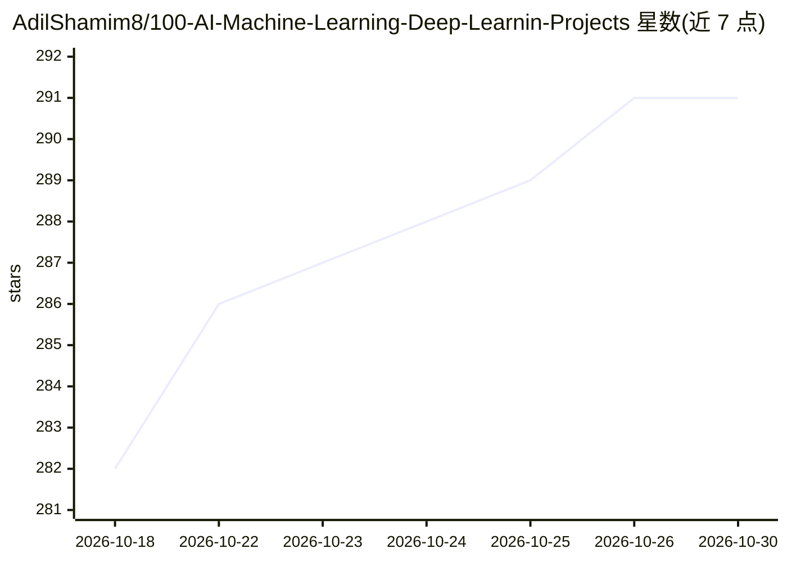

# AdilShamim8/100-AI-Machine-Learning-Deep-Learnin-Projects

⭐ 291 · HTML · 推送 2026-10-12 · [GitHub](https://github.com/AdilShamim8/100-AI-Machine-Learning-Deep-Learnin-Projects) · [官网](https://adilshamim8.github.io/100-AI-Machine-Learning-Deep-Learnin-Projects/) · 个人维护

**个人维护的 100+ AI/ML/DL 项目策展合集，含路线图与实战项目**

个人开发者维护的 AI/ML/DL 项目集合清单：以表格形式列出 110+ 个项目条目，覆盖传统 ML 算法、深度学习架构、计算机视觉、NLP、推荐系统、RAG、多 Agent 系统与生产级 AI 应用等类别；另含 ML/GenAI/Agentic AI 学习路线图、数学基础课程与面试研究档案。每个条目给出名称、描述与标签，清单声明定期更新。README 未提供本仓库自身的安装运行说明，各项目为独立条目链接。

## 筛选速览

| 维度 | 判定 | 备注 |
|---|---|---|
| AI 角色 | `ai-knowledge` | 知识聚合/清单类 |
| 许可风险 | `none` | — |
| 部署形态 | `None` |  |
| 模型依赖 | — | README 未给出锁定关系 |
| 硬件要求 | — | 无带数字的原话,不猜 |
| 安装摩擦 | `low` | 无编译、无系统依赖或容器化 |
| 成熟度 | — | 结构信号不足 |

## 能力要点

- 110+ 个项目条目按 NLP/CV/推荐系统/生产 AI/Agent 等 12 个以上类别组织
- 含 ML、GenAI（LangChain）、Agentic AI（LangGraph）三条学习路线图
- 覆盖从零实现算法（GPT-2 复现、纯 Python ML 库）到生产级 RAG 与多 Agent 平台
- 声明清单定期更新并新增项目

## 适用场景

- 入门者按路线图系统学习 ML/GenAI/Agentic AI
- 从业者查找参考实现与生产级项目模板
- 浏览 AI 工程各方向的代表性项目以确定学习或选型方向

## 场景标签

`精选清单` `教程课程` · 领域:学习与行业

## 证据(README 行号)

> L3: > **A curated, production-grade collection of 100 AI, Machine Learning, and Deep Learning projects** — refined over 
> L33: |#|Project|Description|Tags|

## 星数曲线

2026-10-18 282 → 2026-10-30 291（+9）

---
*卡片 v1 · prompt 1.4 · 生成 2026-10-22 · 置信度 high · 依据 README sha `c69e346d05b3` · [字段定义](../../DATASET.md)*
