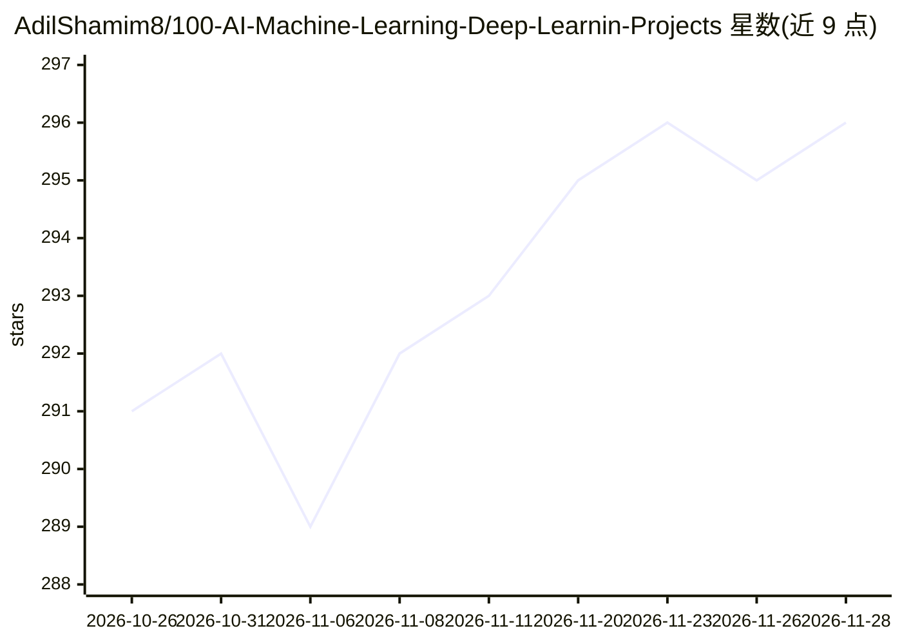

# AdilShamim8/100-AI-Machine-Learning-Deep-Learnin-Projects

⭐ 296 · HTML · 推送 2026-11-16 · [GitHub](https://github.com/AdilShamim8/100-AI-Machine-Learning-Deep-Learnin-Projects) · [官网](https://adilshamim8.github.io/100-AI-Machine-Learning-Deep-Learnin-Projects/) · 个人维护

**AI/ML/深度学习项目合集：为学习者提供100个项目参考**

策展型清单仓库，收录100个AI、机器学习与深度学习项目条目，按经典ML、神经网络架构、计算机视觉、NLP、推荐系统、数据分析、生产级AI系统、Agentic AI路线图等类别组织。每个条目附描述与标签，部分项目为带代码的实现（如RAG API、多智能体系统、预测系统），部分为路线图与学习笔记。面向AI入门者与寻求参考实现的有经验从业者，README 未提供统一安装步骤，条目为独立项目链接集合。

## 筛选速览

| 维度 | 判定 | 备注 |
|---|---|---|
| AI 角色 | `ai-knowledge` | 知识聚合/清单类 |
| 许可风险 | `none` | — |
| 部署形态 | `None` |  |
| 模型依赖 | — | README 未给出锁定关系 |
| 硬件要求 | — | 无带数字的原话,不猜 |
| 安装摩擦 | `low` | 无编译、无系统依赖或容器化 |
| 成熟度 | — | 结构信号不足 |

## 能力要点

- 收录100个项目条目，按ML/DL/CV/NLP/推荐系统/数据分析等类别组织
- 含10个 Agentic AI 实践项目（研究Agent、多Agent客服、MCP Agent等）
- 含生产级AI系统条目（LLM训练部署框架、RAG客服、多模态生成）
- 列表声明定期更新，新增项目

## 适用场景

- 按路线图系统学习机器学习与生成式AI
- 为特定任务查找参考实现（价格预测、情感分析、姿态检测等）
- 了解 Agentic AI 与 RAG 的实践项目形态

## 场景标签

`精选清单` · 领域:学习与行业

## 证据(README 行号)

> L3: > **A curated, production-grade collection of 100 AI, Machine Learning, and Deep Learning projects** — refined over 
> L29: ## Project List
> L124: ### 🤖 Agentic AI Roadmap — Practice Projects

## 星数曲线

2026-10-26 291 → 2026-11-28 296（+5）

---
*卡片 v1 · prompt 1.4 · 生成 2026-11-25 · 置信度 high · 依据 README sha `7e1b05eb89a8` · [字段定义](../../DATASET.md)*
