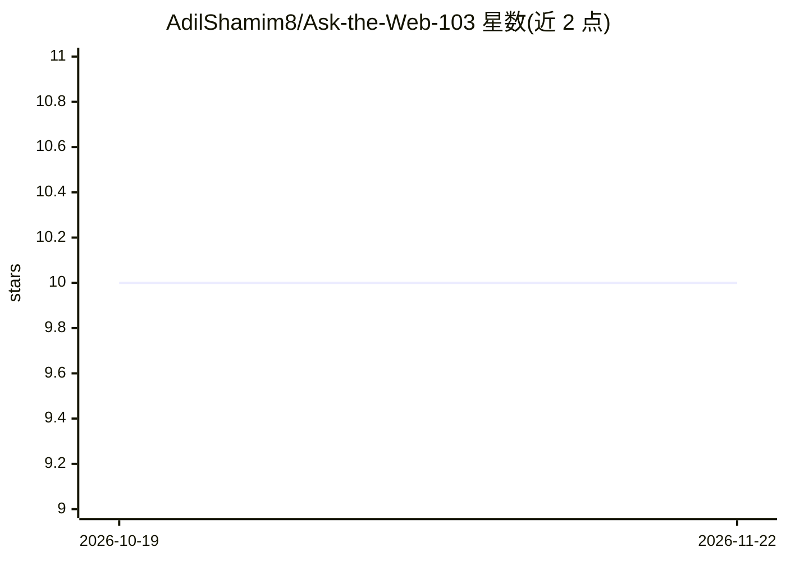

# AdilShamim8/Ask-the-Web-103

⭐ 10 · Python · MIT · 推送 2026-11-14 · [GitHub](https://github.com/AdilShamim8/Ask-the-Web-103) · [官网](https://ask-the-web.space-z.ai/) · 个人维护

**面向自托管用户的类 Perplexity 联网问答 AI agent 服务**

以 FastAPI 实现的 AI research assistant：接收自然语言问题后执行规划、实时网页搜索（Tavily/SerpAPI）、页面抓取、多步推理、自批判验证（Reflexion）与带引用的流式答案输出。提供五种 agent 策略（ReACT/Reflexion/ReWOO/Orchestrator/Tree Search）自动或手动路由，SSE 流式 API，Redis 响应缓存与限速，LLM-as-Judge 评测与基准测试集，Prometheus 指标与 Docker Compose 部署。需要 OpenAI 与 Tavily API key 方可运行。

## 筛选速览

| 维度 | 判定 | 备注 |
|---|---|---|
| AI 角色 | `ai-native` | 本体是模型或模型工具 |
| 许可风险 | `permissive` | MIT |
| 部署形态 | `self-host` | docker 或自建部署 |
| 模型依赖 | locked-api |  |
| 硬件要求 | — | 无带数字的原话,不猜 |
| 安装摩擦 | `low` | 无编译、无系统依赖或容器化 |
| 成熟度 | — | 结构信号不足 |

## 能力要点

- 五种 agent 推理策略，auto 模式由路由器自动选择
- 每个请求携带 token/工具/步数/时钟预算，超限返回部分答案
- SSRF 防护、字节上限与工具结果截断的安全设计
- LLM-as-Judge 评测、文本指标与 5 个内置基准用例

## 适用场景

- 自托管一个带实时引用来源的联网问答服务
- 研究 agent 推理模式（ReACT/ReWOO/Reflexion）的工程实现
- 需要流式输出与可观测成本核算的问答 API

## 场景标签

`聊天机器人` `科研工具` · 领域:对话与助手

## 证据(README 行号)

> L79: **Ask-the-Web Agent** is a production-ready AI research assistant that works
> L85: 1. **Plans** how to answer it (which strategy, how many steps)
> L129: - **REST API** — FastAPI with full OpenAPI docs

## 星数曲线

2026-10-19 10 → 2026-11-22 10（+0）

---
*卡片 v1 · prompt 1.4 · 生成 2026-11-20 · 置信度 high · 依据 README sha `ffe604e7561d` · [字段定义](../../DATASET.md)*
