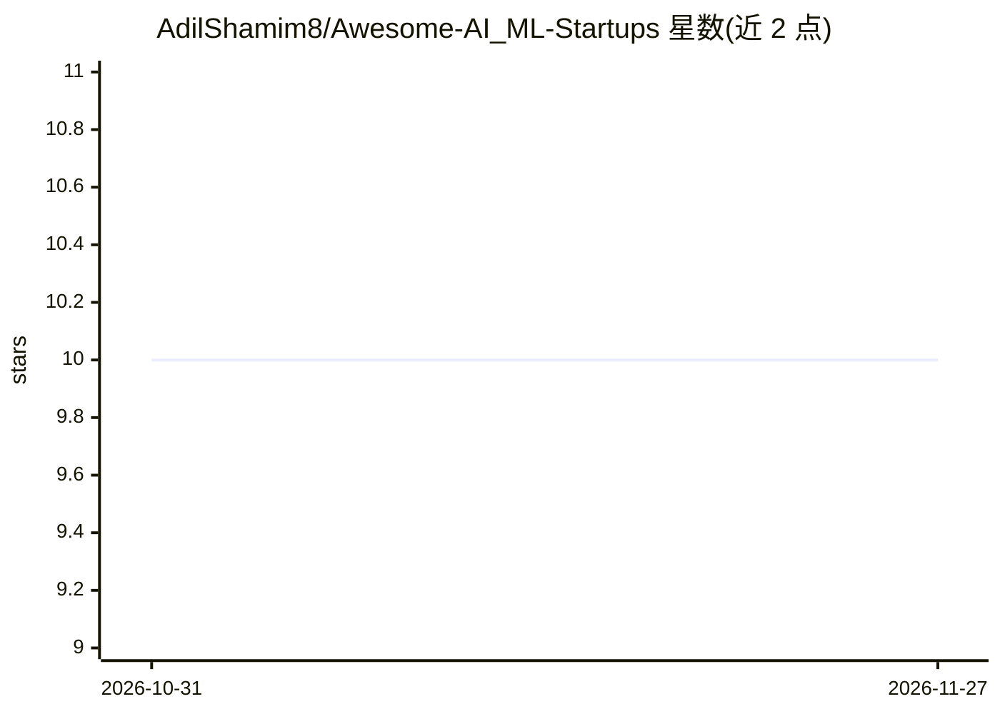

# AdilShamim8/Awesome-AI_ML-Startups

⭐ 10 · HTML · MIT · 推送 2026-10-24 · [GitHub](https://github.com/AdilShamim8/Awesome-AI_ML-Startups) · [官网](https://adilshamim8.github.io/Awesome-AI_ML-Startups/) · 个人维护

**每月更新的 AI/ML 创业公司数据追踪集（118 家公司+193 起融资事件）**

一份以 JSON 主数据文件为核心的 AI/ML 创业公司研究数据集，按月快照更新，覆盖 118 家公司、10 个类别、11 个国家，并记录 2025 年 1 月至 2026 年 10 月的 193 起融资事件。每条记录带来源 URL 与核验状态字段，数据来源为公司公告、财经媒体等五类来源，采用两遍独立来源核验流程。仓库附 CI 校验脚本、字段文档、证据日志，以及一个浏览器直接打开的单文件数据浏览页。明确声明不构成投资建议。

## 筛选速览

| 维度 | 判定 | 备注 |
|---|---|---|
| AI 角色 | `ai-knowledge` | 知识聚合/清单类 |
| 许可风险 | `permissive` | MIT |
| 部署形态 | `None` |  |
| 模型依赖 | — | README 未给出锁定关系 |
| 硬件要求 | — | 无带数字的原话,不猜 |
| 安装摩擦 | `low` | 无编译、无系统依赖或容器化 |
| 成熟度 | — | 结构信号不足 |

## 能力要点

- 118 家公司主数据集与 193 条事件级融资记录（funding_rounds.csv）
- 每行带 source/source_urls/last_verified/verification_status 完整溯源字段
- CI 中运行的校验脚本、CSV/JSON 一致性检查与单元测试
- 仓库根目录自带单文件 index.html 数据浏览页，无需服务器或构建步骤

## 适用场景

- 按月跟踪 AI/ML 创业公司的融资轮次、估值与并购动态
- 检索特定类别或国家的 AI 创业公司及其投资人信息
- 基于带来源引用的数据做行业研究或撰写报告

## 场景标签

 · 领域:数据集/行业研究

## 证据(README 行号)

> L10: > A monthly tracker of AI/ML startups. 118 companies across 11 countries plus an event-level funding history coveri
> L22: A monthly snapshot of the private AI/ML startup landscape, built around one canonical master dataset. You get:
> L31: - **Full provenance** — `source`, `source_urls`, `last_verified`, and an honest `verification_status` on every row 

## 星数曲线

2026-10-31 10 → 2026-11-27 10（+0）

---
*卡片 v1 · prompt 1.4 · 生成 2026-11-20 · 置信度 high · 依据 README sha `41797e13eb6b` · [字段定义](../../DATASET.md)*
