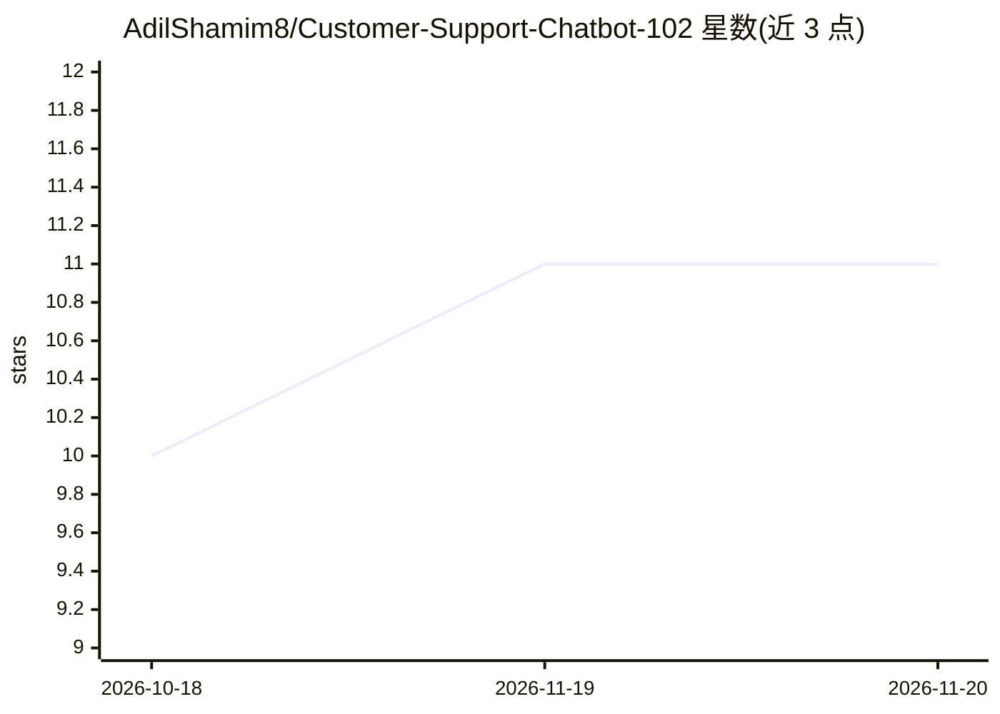

# AdilShamim8/Customer-Support-Chatbot-102

⭐ 11 · Python · MIT · 推送 2026-10-15 · [GitHub](https://github.com/AdilShamim8/Customer-Support-Chatbot-102) · [官网](https://ragchatbot1.space-z.ai) · 个人维护

**基于 RAG 的客服问答系统：以自有文档为依据回答客户问题**

面向客服场景的问答系统，采用检索增强生成（RAG）回答客户问题，检索层提供 6 种分块策略、3 种向量库（ChromaDB/FAISS/Pinecone）、BM25/Elasticsearch 关键词引擎与 RRF 混合检索及 3 种重排序器；生成层支持 5 种提示策略、用户上下文注入、幻觉检测与引用来源；另含 LoRA/QLoRA 微调与 RAGAS 评估集成。以 FastAPI 服务形式部署，提供 Docker Compose 与 Kubernetes/Terraform 部署栈，需至少一个 LLM provider 的 API key。

## 筛选速览

| 维度 | 判定 | 备注 |
|---|---|---|
| AI 角色 | `ai-native` | 本体是模型或模型工具 |
| 许可风险 | `permissive` | MIT |
| 部署形态 | `self-host` | docker 或自建部署 |
| 模型依赖 | locked-api |  |
| 硬件要求 | `gpu-8g` | |
| 安装摩擦 | `low` | 无编译、无系统依赖或容器化 |
| 成熟度 | — | 结构信号不足 |

## 能力要点

- 6 种分块策略 + BM25/向量混合检索与 RRF 融合
- 3 种重排序器：Cohere API、本地 CrossEncoder、FlashRank
- LoRA/QLoRA 微调与 RAFT 数据集自动生成
- RAGAS 评估框架集成与自动化评估 CLI

## 适用场景

- 让客服机器人基于公司文档和政策回答用户问题
- 对上传的支持文档建立可更新的检索索引而无需重训模型
- 对问答质量做忠实度与相关性评估并作为发布门禁

## 场景标签

`聊天机器人` `RAG` `微调` · 领域:对话与助手

## 证据(README 行号)

> L38: This system is a **production-grade customer support chatbot** that combines the
> L102: - **Multi-provider LLM support**: OpenAI GPT-4o, Anthropic Claude 3
> L130: - **FastAPI** with async endpoints, SSE streaming, and OpenAPI docs

## 星数曲线

2026-10-18 10 → 2026-11-20 11（+1）

---
*卡片 v1 · prompt 1.4 · 生成 2026-11-19 · 置信度 mid · 依据 README sha `0dea9e506d35` · [字段定义](../../DATASET.md)*
