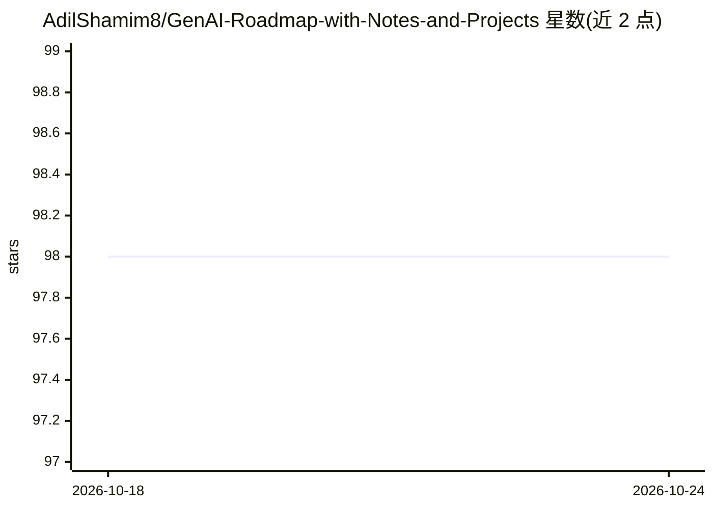

# AdilShamim8/GenAI-Roadmap-with-Notes-and-Projects

⭐ 98 · Python · MIT · 推送 2026-10-20 · [GitHub](https://github.com/AdilShamim8/GenAI-Roadmap-with-Notes-and-Projects) · 个人维护

**面向生产级 GenAI 工程师的 12 级学习路线图与项目集**

以 evals-first 为组织原则的生成式 AI 工程学习路线图仓库：内容按 0-11 共 12 个层级（rung）编号组织，覆盖 LLM 调用、上下文工程、RAG、工具与 MCP、单/多 Agent、评测、生产部署、微调与自托管、安全对齐、实时语音等主题，每主题一个文件夹并遵循统一模板。另提供 6 条按背景（后端/前端/数据工程/数据科学/ML/零基础）划分的学习路径、15 个带代码与测试和评测骨架的作品集项目、6 份决策指南与策展外部资源。事实性声明在 LAST_VERIFIED.md 中标注核验日期。面向能读懂 Python 与 HTTP 的学习者，非入门教程。

## 筛选速览

| 维度 | 判定 | 备注 |
|---|---|---|
| AI 角色 | `ai-knowledge` | 知识聚合/清单类 |
| 许可风险 | `permissive` | MIT |
| 部署形态 | `None` |  |
| 模型依赖 | — | README 未给出锁定关系 |
| 硬件要求 | — | 无带数字的原话,不猜 |
| 安装摩擦 | `low` | 无编译、无系统依赖或容器化 |
| 成熟度 | — | 结构信号不足 |

## 能力要点

- 12 个编号层级的技能阶梯，从基础到实时语音共 12 个主题文件夹
- 15 个作品集项目，各带 README/src/tests/evals/DEPLOYMENT 结构
- 6 份决策指南（选 Agent SDK、选向量库、RAG vs 长上下文等）
- 事实声明在 LAST_VERIFIED.md 中逐条标注核验日期

## 适用场景

- 按自身背景选择学习路径系统学习生产级 GenAI 工程
- 通过带测试与评测骨架的项目构建求职作品集
- 在技术选型分岔处查阅决策指南

## 场景标签

`教程课程` `精选清单` · 领域:学习与行业

## 证据(README 行号)

> L14: A **rigorously-sourced, file-per-topic, evals-first** roadmap for becoming a production GenAI engineer. Every factu
> L26: |Rung|Topic|Folder|Est. time|

## 星数曲线

2026-10-18 98 → 2026-10-24 98（+0）

---
*卡片 v1 · prompt 1.4 · 生成 2026-10-23 · 置信度 high · 依据 README sha `95be6ddd27e2` · [字段定义](../../DATASET.md)*
