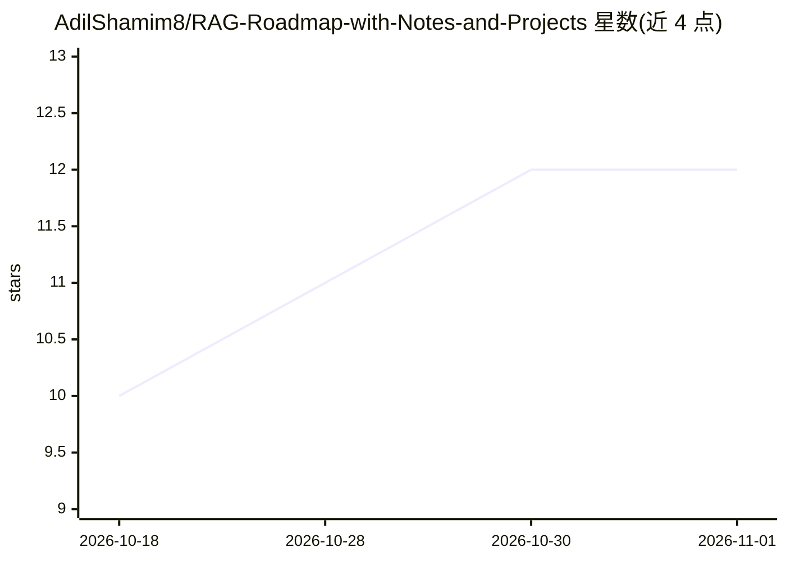

# AdilShamim8/RAG-Roadmap-with-Notes-and-Projects

⭐ 12 · MIT · 推送 2026-09-21 · [GitHub](https://github.com/AdilShamim8/RAG-Roadmap-with-Notes-and-Projects) · 个人维护

**面向工程师的 RAG 端到端学习路线：从文档处理到 Agentic RAG 与生产部署**

一个结构化的 RAG 学习课程仓库，按 10 个模块组织，覆盖文档加载与分块、嵌入模型选型、向量存储 CRUD、检索策略（MMR/混合检索）、RAG Fusion/HyDE/CRAG/Self-RAG/Graph RAG 等进阶模式、基于 LangGraph 的 Agentic RAG、RAGAS 评估与生产部署监控。要求读者先掌握 Python 基础、LangChain 与 LangGraph 基础。每个模块配有动手实验；多模态 RAG 与毕业项目标注为 coming soon。内容更新至 2026 年 6 月的生态版本。

## 筛选速览

| 维度 | 判定 | 备注 |
|---|---|---|
| AI 角色 | `ai-knowledge` | 知识聚合/清单类 |
| 许可风险 | `permissive` | MIT |
| 部署形态 | `library` | 以包/库形式分发 |
| 模型依赖 | — | README 未给出锁定关系 |
| 硬件要求 | — | 无带数字的原话,不猜 |
| 安装摩擦 | `low` | 无编译、无系统依赖或容器化 |
| 成熟度 | — | 结构信号不足 |

## 能力要点

- 10 模块课程覆盖从文档分块到 Agentic RAG 与生产部署
- 覆盖 CRAG、Self-RAG、Graph RAG（Neo4j）等进阶模式
- 附 RAGAS 评估指标与 chunk 尺寸/嵌入模型选型参考表
- 每模块含动手实验（Hands-on/Lab）

## 适用场景

- 系统学习 RAG 从基础到生产部署的完整路径
- 选型时查阅分块策略、嵌入模型与向量库参考表
- 为团队培训或自学搭建循序渐进的 RAG 课程

## 场景标签

`教程课程` `RAG` · 领域:知识与检索

## 证据(README 行号)

> L9: **A comprehensive, end-to-end learning path for Retrieval-Augmented Generation —**
> L33: This repository provides a **structured, step-by-step curriculum** for mastering Retrieval-Augmented Generation (RA
> L97: RAG Roadmap — 10 Modules

## 星数曲线

2026-10-18 10 → 2026-11-01 12（+2）

---
*卡片 v1 · prompt 1.4 · 生成 2026-11-01 · 置信度 mid · 依据 README sha `68fa06226222` · [字段定义](../../DATASET.md)*
