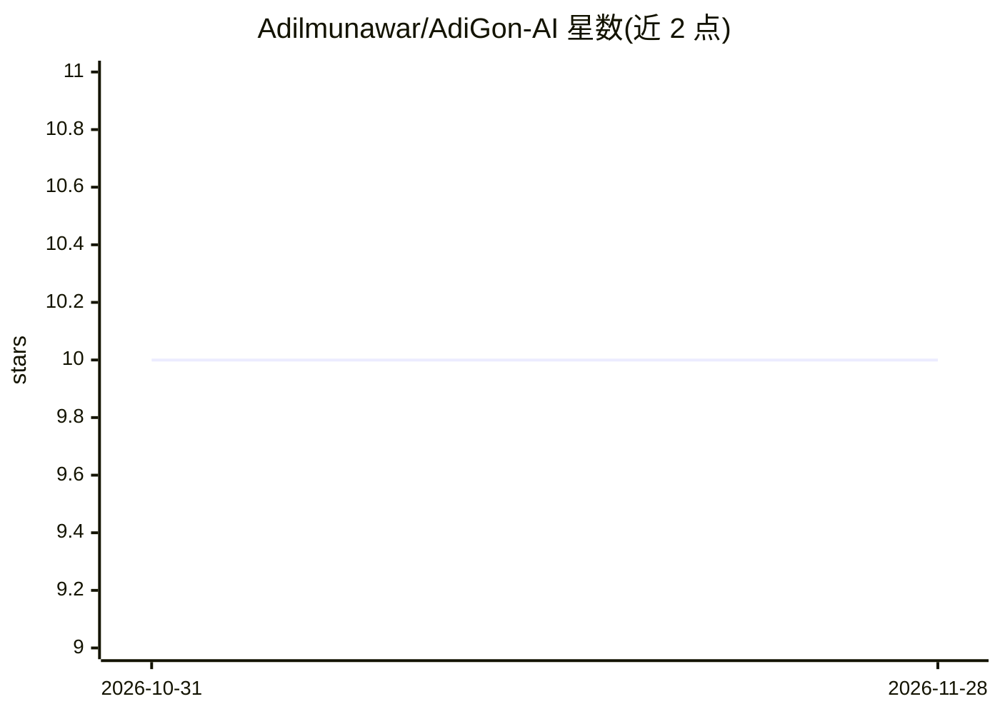

# Adilmunawar/AdiGon-AI

⭐ 10 · TypeScript · 推送 2026-03-08 · [GitHub](https://github.com/Adilmunawar/AdiGon-AI) · [官网](https://adigon.vercel.app) · 个人维护

**面向终端用户的 AI 助手应用，支持多格式文件与语音输入**

以 TypeScript 开发的 AI 助手应用 adigon，核心功能包括：通过 AI 算法处理输入数据并生成结果、提供用户交互界面、自动化关键任务、与外部平台和服务集成。根据仓库描述，它支持处理多种格式的文件响应，并内置语音识别系统；README 还提及开发者模式（developer mode）等特色功能。文档另含工作流程图、数据库结构图与应用功能说明图，由个人开发者 Adil Munawar 维护。

## 筛选速览

| 维度 | 判定 | 备注 |
|---|---|---|
| AI 角色 | `ai-native` | 本体是模型或模型工具 |
| 许可风险 | `none` | — |
| 部署形态 | `None` |  |
| 模型依赖 | — | README 未给出锁定关系 |
| 硬件要求 | — | 无带数字的原话,不猜 |
| 安装摩擦 | `low` | 无编译、无系统依赖或容器化 |
| 成熟度 | — | 结构信号不足 |

## 能力要点

- 处理多种格式文件的输入响应
- 内置语音识别系统
- TypeScript 开发，定位为可扩展的智能自动化应用
- 支持与外部平台和服务集成

## 适用场景

- 与 AI 助手进行对话获取回答
- 输入多种格式的文件获得处理结果
- 通过语音与助手交互

## 场景标签

`AI 助手` `语音识别` · 领域:对话与助手

## 证据(README 行号)

> L7: This AI application, adigon, is developed using TypeScript and is designed for scalable, intelligent automation. The
> L8: Data Processing: Efficiently handles input data and processes it through AI-driven algorithms to generate actionable

## 星数曲线

2026-10-31 10 → 2026-11-28 10（+0）

---
*卡片 v1 · prompt 1.4 · 生成 2026-11-20 · 置信度 mid · 依据 README sha `aa7e172355dc` · [字段定义](../../DATASET.md)*
