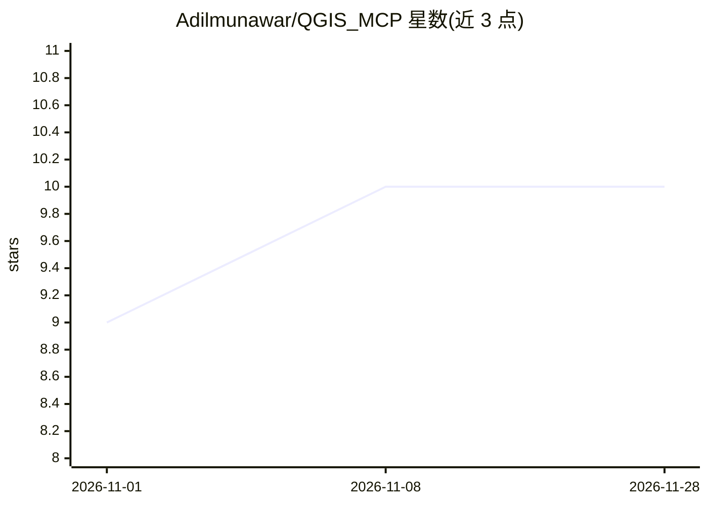

# Adilmunawar/QGIS_MCP

⭐ 10 · Python · NOASSERTION · 推送 2026-11-01 · [GitHub](https://github.com/Adilmunawar/QGIS_MCP) · 个人维护

**QGIS 开放数据工具箱与经权限管控的 MCP 服务器，供 AI 代理操作 GIS**

面向 QGIS 的插件式工具箱，含两部分：Data Explorer 停靠面板在不依赖 AI 的情况下一键获取卫星影像（Sentinel-2/Landsat）、气象、DEM 高程、OpenStreetMap 等公开数据并生成图层与 NDVI 等指数分析；另提供基于 Model Context Protocol 的服务器与 QGIS 内 socket 桥，使 Claude Desktop、Claude Code、Cursor、VS Code 等客户端用自然语言操作 QGIS 工程。命令按读写/破坏性分级，经权限配置、审批队列与 JSONL 审计日志管控，破坏性编辑默认 dry run。需 QGIS 与 Python 3.12+。

## 筛选速览

| 维度 | 判定 | 备注 |
|---|---|---|
| AI 角色 | `ai-ecosystem` | LLM/agent 周边工具 |
| 许可风险 | `none` | NOASSERTION |
| 部署形态 | `None` |  |
| 模型依赖 | — | README 未给出锁定关系 |
| 硬件要求 | — | 无带数字的原话,不猜 |
| 安装摩擦 | `low` | 无编译、无系统依赖或容器化 |
| 成熟度 | — | 结构信号不足 |

## 能力要点

- Data Explorer 面板 17 个标签页接入公开地理数据源，无需 AI、API key（少数免费 key 除外）
- MCP 服务器让 Claude/Cursor/VS Code 客户端用自然语言操作 QGIS
- 命令风险分级 + 权限配置 + 审批队列 + 只追加审计日志
- 破坏性编辑默认 dry run，未知命令按破坏性处理

## 适用场景

- 在 QGIS 中一键加载某区域的影像、气象、DEM、OSM 图层
- 让 AI 助手代为执行缓冲区、裁剪、几何检查等 GIS 分析
- 农田 NDVI 长势监测与田块状态评级
- 需要审计 AI 对工程做了哪些改动的团队环境

## 场景标签

 · 领域:地理空间/GIS 工具

## 证据(README 行号)

> L5: **A geospatial data toolbox for QGIS. The Data Explorer brings live satellite imagery, weather, elevation and OpenSt
> L60: QGIS MCP is a **QGIS AI assistant** built on the Model Context Protocol. It runs a small socket bridge inside QGIS 
> L73: What sets it apart from a plain "run any code" bridge is **safety**. Every command carries a risk category (read, w

## 星数曲线

2026-11-01 9 → 2026-11-28 10（+1）

---
*卡片 v1 · prompt 1.4 · 生成 2026-11-20 · 置信度 high · 依据 README sha `c0f1385020c6` · [字段定义](../../DATASET.md)*
