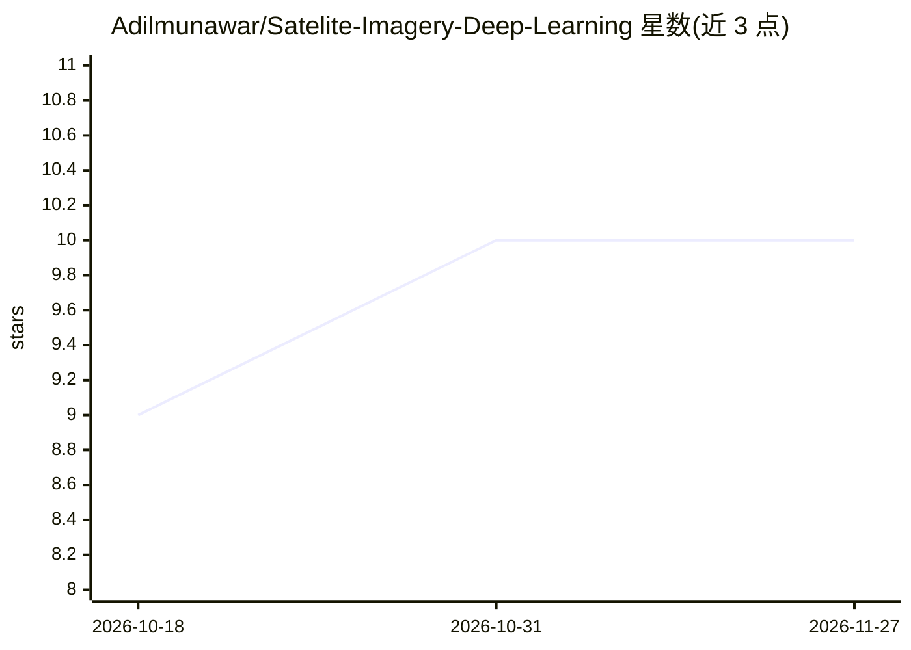

# Adilmunawar/Satelite-Imagery-Deep-Learning

⭐ 10 · Apache-2.0 · 推送 2026-09-03 · [GitHub](https://github.com/Adilmunawar/Satelite-Imagery-Deep-Learning) · 个人维护

**遥感/卫星影像深度学习资源清单：按任务分类收录模型与数据集**

面向地球观测领域的精选清单（awesome list），按任务与应用域组织收录深度学习架构、模型与算法条目：覆盖分类、多类语义分割（土地覆盖、水体、火灾、建筑、船只等）、目标检测与跟踪、超分辨率、变化检测、SAR、时序等；使用方式为页面内搜索关键词（如 'SAM'）定位条目，条目附一句话说明并链接至外部项目或论文，支持社区贡献并附行为准则。

## 筛选速览

| 维度 | 判定 | 备注 |
|---|---|---|
| AI 角色 | `ai-knowledge` | 知识聚合/清单类 |
| 许可风险 | `permissive` | Apache-2.0 |
| 部署形态 | `library` | 以包/库形式分发 |
| 模型依赖 | — | README 未给出锁定关系 |
| 硬件要求 | — | 无带数字的原话,不猜 |
| 安装摩擦 | `low` | 无编译、无系统依赖或容器化 |
| 成熟度 | — | 结构信号不足 |

## 能力要点

- 按任务组织：分类、分割（十余类地物）、检测/跟踪、回归、检索、VQA 等
- 高级方法板块：超分辨率、数据融合、自监督、联邦学习、基础模型与 LLM/LVLM
- 应用域板块：云检测、变化检测、作物分类、灾害响应、SAR、NDVI、XAI 等
- 支持 CTRL+F 页内搜索定位条目，附贡献指南

## 适用场景

- 为遥感影像分类/分割任务查找现成模型与数据集
- 调研地球观测领域的深度学习方法综述
- 针对特定地物（建筑、船只、太阳能板）寻找检测方案

## 场景标签

`精选清单` · 领域:学习与行业

## 证据(README 行号)

> L3:  A comprehensive repository of deep learning architectures, models, and algorithms suited for Earth observation, cla
> L7: Deep learning has revolutionized the analysis and interpretation of satellite and aerial imagery, addressing unique 
> L9: **How to use this repository:** use `Command + F` (Mac) or `CTRL + F` (Windows) to search this page for e.g. 'SAM'

## 星数曲线

2026-10-18 9 → 2026-11-27 10（+1）

---
*卡片 v1 · prompt 1.4 · 生成 2026-11-20 · 置信度 mid · 依据 README sha `2ca46c853fb0` · [字段定义](../../DATASET.md)*
