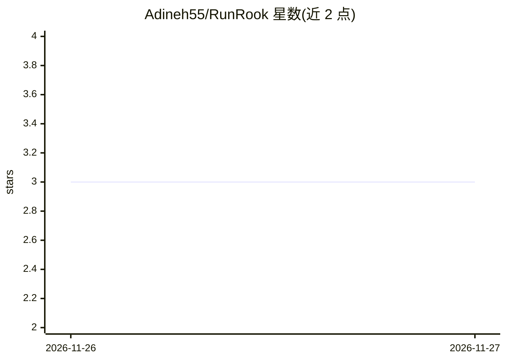

# Adineh55/RunRook

⭐ 3 · NOASSERTION · 推送 2026-11-26 · [GitHub](https://github.com/Adineh55/RunRook) · [官网](https://runrook.app) · 组织维护

**监控 Mac 上 AI agent 会话的原生应用：及时提醒并代为回复**

一款原生 macOS 应用，把本机及局域网内其他电脑上运行的 AI agent 会话集中到一个列表中查看：显示每条会话的消息、回复、已执行命令与失败记录；当 agent 等待用户时通过通知中心与菜单栏提醒，可直接在应用内回答 agent 的提问、发送跟进消息，并对权限提示执行 Allow/Deny。支持连接 Claude Code、Codex、基于 Claude Agent SDK 的 agent、Ollama 与 LM Studio 本地模型及 Cursor。会话文本保留在本机，应用声明不做分析统计；免费版有连接数与查看者数限制，Pro 为一次性付费。

## 筛选速览

| 维度 | 判定 | 备注 |
|---|---|---|
| AI 角色 | `ai-ecosystem` | LLM/agent 周边工具 |
| 许可风险 | `none` | NOASSERTION |
| 部署形态 | `desktop` | 安装包/桌面程序 |
| 模型依赖 | local-ok | 支持本地模型 |
| 硬件要求 | — | 无带数字的原话,不猜 |
| 安装摩擦 | `low` | 无编译、无系统依赖或容器化 |
| 成熟度 | — | 结构信号不足 |

## 能力要点

- 多来源会话集中列表：Claude Code、Codex、Claude Agent SDK、Ollama/LM Studio、Cursor
- agent 等待时通过通知中心与菜单栏提醒，支持在应用内回复与 Allow/Deny
- 跨电脑连接：一行配置命令接入其他 Mac/Linux/Windows 设备
- 只读监控隐私声明：对话文本留在本机，不发送给查看者

## 适用场景

- 同时运行多个 AI coding agent 时统一查看各会话状态
- agent 卡住等待确认时收到通知并代为放行或拒绝
- 在别的电脑上查看另一台机器上 agent 的运行情况

## 场景标签

`LLM 可观测性` · 领域:评测与运维

## 证据(README 行号)

> L5:  See every AI agent running on your computers in one native Mac app.
> L14: - **Every session in one list:** Claude Code and Codex (including sessions started before RunRook opened, and the l

## 星数曲线

2026-11-26 3 → 2026-11-27 3（+0）

---
*卡片 v1 · prompt 1.4 · 生成 2026-11-26 · 置信度 high · 依据 README sha `93fb89391850` · [字段定义](../../DATASET.md)*
