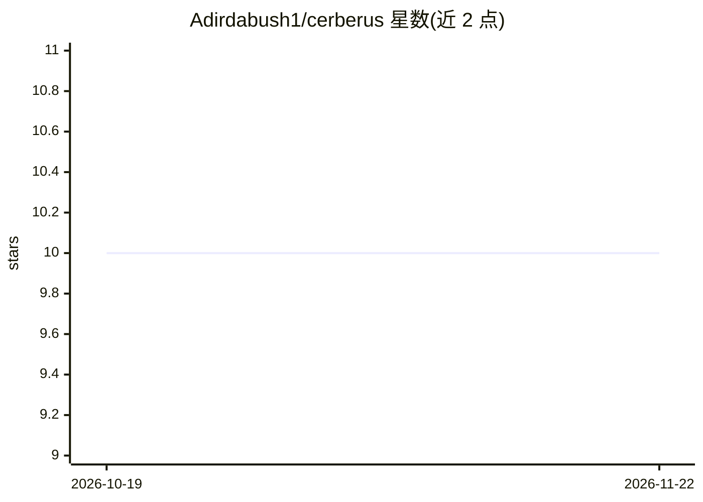

# Adirdabush1/cerberus

⭐ 10 · TypeScript · Apache-2.0 · 推送 2026-10-28 · [GitHub](https://github.com/Adirdabush1/cerberus) · 个人维护

**AI 编程 agent 的本地安全网关：拦截与审批每次工具调用**

以本地优先方式部署在 agent（Claude Code、Codex CLI、Cursor、Cline）与机器之间的运行时安全网关。通过 PreToolUse 钩子拦截每次工具调用，用策略、行为、内容、注入四个确定性信号计算风险分，输出 ALLOW/AUDIT/HITL/BLOCK 四种裁决；PostToolUse 钩子检测密钥与注入，维护会话污染状态。通过 `cerberus init --agent <name>` 将钩子写入 agent 配置；审批可在终端原生权限提示或本地 dashboard 完成。无外部 API，密钥值不落盘。覆盖工具边界上的注入利用，不覆盖 RAG/数据管道投毒。

## 筛选速览

| 维度 | 判定 | 备注 |
|---|---|---|
| AI 角色 | `ai-ecosystem` | LLM/agent 周边工具 |
| 许可风险 | `permissive` | Apache-2.0 |
| 部署形态 | `library` | 以包/库形式分发 |
| 模型依赖 | — | README 未给出锁定关系 |
| 硬件要求 | — | 无带数字的原话,不猜 |
| 安装摩擦 | `low` | 无编译、无系统依赖或容器化 |
| 成熟度 | — | 结构信号不足 |

## 能力要点

- 每次工具调用经四信号风险评分，输出 ALLOW/AUDIT/HITL/BLOCK
- 密钥外泄检测：上下文密钥与出站载荷内容匹配，含来源溯源
- 本地优先：绑定 127.0.0.1，无外部 API、无遥测，规则为可编辑 YAML
- 适配层支持 Claude Code/Codex/Cursor/Cline 四个 agent

## 适用场景

- 阻止 agent 执行 rm -rf、误推 git、外泄 .env 等危险操作
- 为无人值守运行的编程 agent 加一道人工审批关卡
- 检测并拦截携带密钥的出站请求（含 base64/hex/URL 编码）
- 审计回放某次会话风险是如何累积的

## 场景标签

`网络安全` · 领域:学习与行业

## 证据(README 行号)

> L9: A **local-first security gateway for autonomous AI coding agents.** Cerberus sits between the agent
> L10: (Claude Code, Codex, Cursor, Cline) and your machine, intercepts **every tool call** before it runs,
> L47: - **Multi-agent** — one adapter layer serves Claude Code, Codex, Cursor, and Cline.

## 星数曲线

2026-10-19 10 → 2026-11-22 10（+0）

---
*卡片 v1 · prompt 1.4 · 生成 2026-11-20 · 置信度 high · 依据 README sha `2dfe2fda057a` · [字段定义](../../DATASET.md)*
