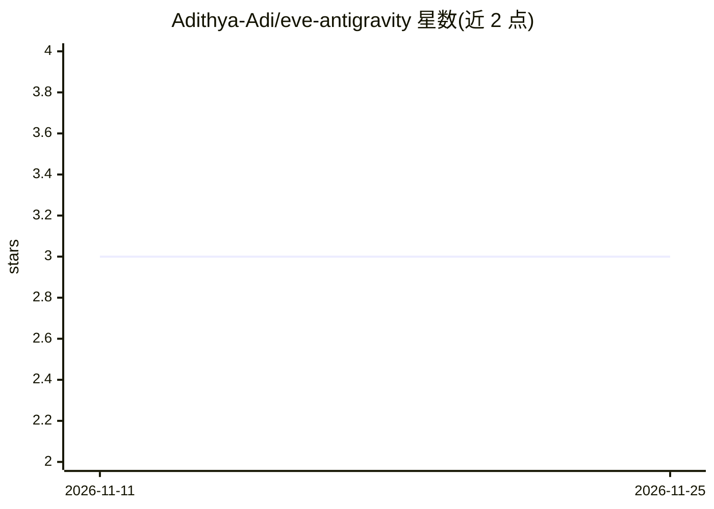

# Adithya-Adi/eve-antigravity

⭐ 3 · TypeScript · MIT · 推送 2026-11-21 · [GitHub](https://github.com/Adithya-Adi/eve-antigravity) · [官网](https://www.npmjs.com/package/eve-antigravity) · 个人维护

**让开发者把 Antigravity CLI 登录接入 eve agents 的模型适配包**

一个 npm 包，把本地 Antigravity CLI（agy）的登录态封装为 AI SDK 的 LanguageModel，供 eve agents 框架调用。机制：将对话展平为单条提示词，通过 stdin 以 stream-json 驱动 `agy --print` 子进程，以 `<tool_calls>` 文本块解析工具调用，工具执行由 eve 完成。支持流式输出、schema 约束的 JSON 输出、MCP 工具；不支持图片输入与 temperature 等参数。需要 Node.js 20+、已安装并登录的 agy、eve 0.83+。非官方包，README 提示重用可能触发限额或账号风险。

## 筛选速览

| 维度 | 判定 | 备注 |
|---|---|---|
| AI 角色 | `ai-ecosystem` | LLM/agent 周边工具 |
| 许可风险 | `permissive` | MIT |
| 部署形态 | `self-host` | docker 或自建部署 |
| 模型依赖 | — | README 未给出锁定关系 |
| 硬件要求 | — | 无带数字的原话,不猜 |
| 安装摩擦 | `low` | 无编译、无系统依赖或容器化 |
| 成熟度 | — | 结构信号不足 |

## 能力要点

- 将 agy 登录态封装为 AI SDK LanguageModel，支持流式输出与工具调用
- agy 以隔离 home 运行且禁用其自带工具，登录态保存在 OS keyring
- 提供登录状态检查、模型列表与 Google 登录流程的编程接口
- 文档给出 Linux 容器/Kubernetes 中保持登录的方案

## 适用场景

- 在 eve agents 中用 Antigravity 订阅驱动 agent 循环
- 为自有应用添加 agy 模型的流式对话与工具调用
- 在容器化部署中通过卷持久化 agy 登录态

## 场景标签

`模型网关` · 领域:Agent 开发

## 证据(README 行号)

> L9: Use the models from your local Antigravity CLI (`agy`) login inside eve agents. It works like eve's `chatgpt()` help
> L24: eve passes an AI SDK `LanguageModel` to its agent loop. `antigravity()` returns one. For each model call it:
> L36: - `agy` installed and signed in (run `agy` once and sign in with Google)

## 星数曲线

2026-11-11 3 → 2026-11-25 3（+0）

---
*卡片 v1 · prompt 1.4 · 生成 2026-11-22 · 置信度 mid · 依据 README sha `66667cb4b13b` · [字段定义](../../DATASET.md)*
