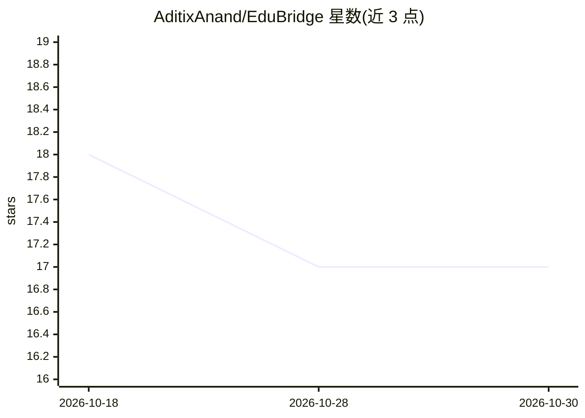

# AditixAnand/EduBridge

⭐ 17 · HTML · MIT · 推送 2026-07-31 · [GitHub](https://github.com/AditixAnand/EduBridge) · 个人维护

**面向学生的全栈学习平台：课程、测验与 AI 学习指导**

Python/Flask 后端加 HTML/CSS/JS 前端的全栈 Web 应用：学生可浏览 Web 开发、AI/ML 等技术主题的学习资源，通过测验检验知识，并获得基于 OpenAI API 的学习与职业建议。功能包括用户登录注册、个人资料管理、测验页面与响应式设计，页面覆盖学习、测验、AI 助手与职业指导。安装方式为 git clone 源码后 pip 安装 flask/python-dotenv/openai 依赖，本地运行 app.py 并在浏览器打开 index.html。

## 筛选速览

| 维度 | 判定 | 备注 |
|---|---|---|
| AI 角色 | `ai-enhanced` | 去掉 AI 部分产品仍成立 |
| 许可风险 | `permissive` | MIT |
| 部署形态 | `library` | 以包/库形式分发 |
| 模型依赖 | — | README 未给出锁定关系 |
| 硬件要求 | — | 无带数字的原话,不猜 |
| 安装摩擦 | `low` | 无编译、无系统依赖或容器化 |
| 成熟度 | — | 结构信号不足 |

## 能力要点

- 交互式学习资源与技术主题测验
- 基于 OpenAI API 的学习与职业指导
- 用户认证与个人资料管理
- 响应式设计，支持桌面/平板/移动端

## 适用场景

- 学习 Web 开发与 AI/ML 技术主题并通过测验自测
- 获取 AI 驱动的学习路径与职业建议
- 学生在一个平台上管理学习进度与个人资料

## 场景标签

`教程课程` · 领域:学习与行业

## 证据(README 行号)

> L3: EduBridge is a **full-stack web application** that provides interactive learning resources, quizzes, and AI-driven g
> L17: - 🤖 **AI Assistance** – AI-powered learning and guidance
> L33: - **OpenAI API:** AI-driven features

## 星数曲线

2026-10-18 18 → 2026-10-30 17（-1）

---
*卡片 v1 · prompt 1.4 · 生成 2026-10-30 · 置信度 low · 依据 README sha `75189372fdaa` · [字段定义](../../DATASET.md)*
