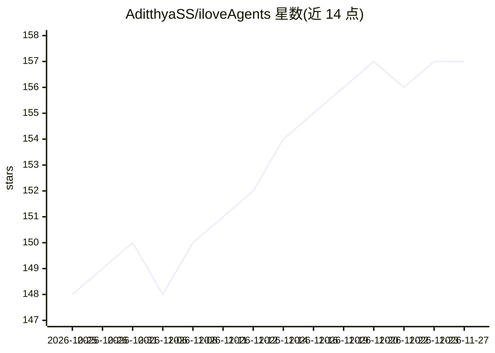

# AditthyaSS/iloveAgents

⭐ 157 · JavaScript · MIT · 推送 2026-11-22 · [GitHub](https://github.com/AditthyaSS/iloveAgents) · [官网](https://iloveagents.vercel.app/) · 个人维护

**浏览器内运行的 AI agents 开源平台：BYOK 即贴即用**

React + Vite 构建的 Web 平台，收录 160+ 配置驱动的 AI agents，覆盖工程、教育、营销、医疗等类别。核心 agent 调用直接在浏览器内完成，用户粘贴自己的 API key，不经中间服务器；可选后端（工作流、定时任务）依赖 Supabase 与 Resend。支持运行时切换 OpenAI/Anthropic/Gemini，提供三方模型对比的 Battle Mode、最多 5 个 agent 串行链式执行的 Workflow Builder、按小时/日/周调度的自动化及邮件通知。MIT 许可，提供在线 Demo 与 Vercel 部署说明。

## 筛选速览

| 维度 | 判定 | 备注 |
|---|---|---|
| AI 角色 | `ai-native` | 本体是模型或模型工具 |
| 许可风险 | `permissive` | MIT |
| 部署形态 | `library` | 以包/库形式分发 |
| 模型依赖 | locked-api |  |
| 硬件要求 | — | 无带数字的原话,不猜 |
| 安装摩擦 | `low` | 无编译、无系统依赖或容器化 |
| 成熟度 | — | 结构信号不足 |

## 能力要点

- 160+ 配置驱动的 agents，新增 agent 只需添加一个 JS 对象
- Battle Mode 将同一 prompt 同时发给三家提供商并比选结果
- Workflow Builder 最多串联 5 个 agent 顺序执行
- BYOK 隐私模式：API key 仅在浏览器内使用，可选 pgsodium 加密存储

## 适用场景

- 在浏览器中直接运行会议纪要、代码审查、SQL 生成等单一任务 agent
- 对比 GPT-4o / Claude Sonnet / Gemini Flash 对同一输入的输出
- 把研究、摘要、写作等 agent 串成一条自动化流程
- 定时运行 agent 并通过邮件接收执行报告

## 场景标签

`工作流自动化` · 领域:效率与自动化

## 证据(README 行号)

> L41: iloveAgents is a clean, open source web platform where you can run AI agents directly in your browser.
> L43: No sign-up. Core agent runs happen right in your browser — just paste your API key and go. Optional backend feature
> L75: > **Note:** The repository currently contains **160+ AI agents** spanning Engineering, Education, Marketing, Health

## 星数曲线

2026-10-25 148 → 2026-11-27 157（+9）

---
*卡片 v1 · prompt 1.4 · 生成 2026-11-27 · 置信度 high · 依据 README sha `dafd6ce1bcfb` · [字段定义](../../DATASET.md)*
