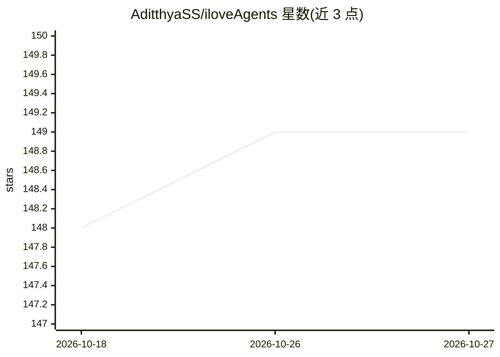

# AditthyaSS/iloveAgents

⭐ 149 · JavaScript · MIT · 推送 2026-10-26 · [GitHub](https://github.com/AditthyaSS/iloveAgents) · [官网](https://iloveagents.vercel.app/) · 个人维护

**浏览器直接运行 160+ 开源 AI agent 的 BYOK Web 平台**

社区共建的开源 Web 平台，用户自带 API 密钥在浏览器中直接运行 160+ 个单任务 AI agent（代码生成、会议纪要、SQL、冷邮件等），覆盖工程、教育、营销、医疗等类别。支持 OpenAI/Anthropic/Gemini/OpenRouter 多供应商运行时切换，密钥默认仅存于浏览器直连供应商。可选后端功能包括 Battle Mode 三家模型并排对比、最多 5 步的 Workflow 串联执行、基于 Supabase pgsodium 加密密钥的定时自动化与 Resend 邮件通知。技术栈为 React/Vite，部署于 Vercel，新增 agent 只需添加一个配置对象。

## 筛选速览

| 维度 | 判定 | 备注 |
|---|---|---|
| AI 角色 | `ai-native` | 本体是模型或模型工具 |
| 许可风险 | `permissive` | MIT |
| 部署形态 | `library` | 以包/库形式分发 |
| 模型依赖 | locked-api |  |
| 硬件要求 | — | 无带数字的原话,不猜 |
| 安装摩擦 | `low` | 无编译、无系统依赖或容器化 |
| 成熟度 | — | 结构信号不足 |

## 能力要点

- 160+ 个单任务 agent，config-driven 架构（加一个 JS 对象即新增 agent）
- BYOK：API 密钥默认只在浏览器内直连 OpenAI/Anthropic/Gemini，不经中间服务器
- Battle Mode 同一提示并发三家模型并排对比
- Workflow Builder 串联最多 5 个 agent 顺序执行，社区工作流库可分享

## 适用场景

- 粘贴 API 密钥即可在浏览器运行单个 AI agent，无需注册与后端
- 把多家模型输出并排对比后人工选优
- 将研究→摘要→发帖等 agent 串成自动化流水线并按小时/天/周定时执行

## 场景标签

`工作流自动化` `模型评测` · 领域:效率与自动化

## 证据(README 行号)

> L41: iloveAgents is a clean, open source web platform where you can run AI agents directly in your browser.
> L49: - **Your API key never leaves your browser.** It goes directly to OpenAI, Anthropic, or Google. No middleman, no st

## 星数曲线

2026-10-18 148 → 2026-10-27 149（+1）

---
*卡片 v1 · prompt 1.4 · 生成 2026-10-22 · 置信度 high · 依据 README sha `c8e9f8a60382` · [字段定义](../../DATASET.md)*
