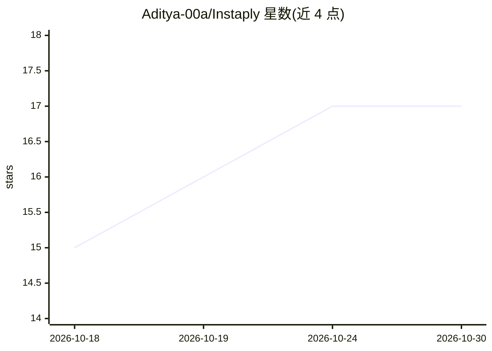

# Aditya-00a/Instaply

⭐ 17 · Python · MIT · 推送 2026-07-01 · [GitHub](https://github.com/Aditya-00a/Instaply) · [官网](https://instaply-web.vercel.app) · 个人维护

**本地优先的求职自动投递 agent，用 Ollama 在你电脑上跑**

在用户本机运行的求职申请自动化 agent：定时从 Greenhouse/Lever/SmartRecruiters 及 JobSpy 聚合源发现职位，按用户画像评分（39 条确定性规则 + LLM 兜底），用 Playwright 打开用户自己的 Chrome 自动填写 23+ 类表单字段，本地 LLM 生成求职信与简历定制；验证码和最终提交始终由用户手动完成。数据存本地 SQLite，setup.py 自动检测硬件并安装 Ollama、选择本地模型。MIT 许可，Python 3.10+，从源码运行。

## 筛选速览

| 维度 | 判定 | 备注 |
|---|---|---|
| AI 角色 | `ai-native` | 本体是模型或模型工具 |
| 许可风险 | `permissive` | MIT |
| 部署形态 | `None` |  |
| 模型依赖 | local-ok | 支持本地模型 |
| 硬件要求 | — | 无带数字的原话,不猜 |
| 安装摩擦 | `low` | 无编译、无系统依赖或容器化 |
| 成熟度 | — | 结构信号不足 |

## 能力要点

- 定时循环发现、评分、定制并起草投递（默认每 30 分钟）
- Playwright 操控用户真实浏览器填写表单，验证码与提交由用户完成
- setup.py 自动检测硬件、安装 Ollama 并选择 3B–70B 本地模型
- 本地 SQLite 审计记录（每职位、每决策、每截图）

## 适用场景

- 批量求职时自动发现和筛选匹配职位并起草投递
- 夜间后台运行，早上审阅投递队列
- 在不经过第三方服务器的前提下自动化填表投递

## 场景标签

`浏览器自动化` · 领域:效率与自动化

## 证据(README 行号)

> L102:  Cover letter drafting Local LLM, conservative prompt with the candidate's grounded experience
> L117:  LLM calls Your local Ollama (default) or your own API key You + your model provider

## 星数曲线

2026-10-18 15 → 2026-10-30 17（+2）

---
*卡片 v1 · prompt 1.4 · 生成 2026-10-30 · 置信度 high · 依据 README sha `2c71203f1274` · [字段定义](../../DATASET.md)*
