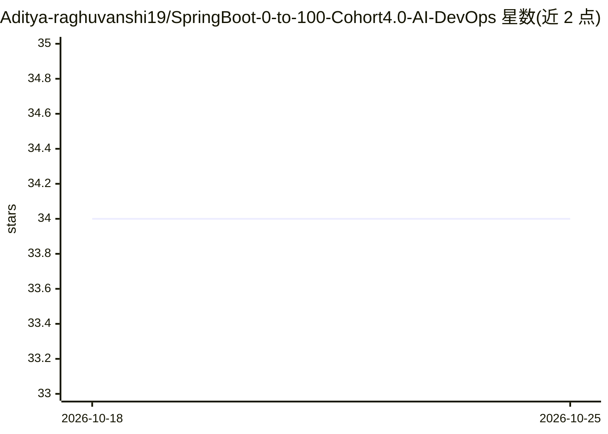

# Aditya-raghuvanshi19/SpringBoot-0-to-100-Cohort4.0-AI-DevOps

⭐ 34 · Java · 推送 2026-01-25 · [GitHub](https://github.com/Aditya-raghuvanshi19/SpringBoot-0-to-100-Cohort4.0-AI-DevOps) · 个人维护

**Spring Boot 后端学习课程仓库：从基础到微服务、DevOps 与 AI 集成**

个人学习仓库，跟随 Coding Shuttle 的 Spring Boot 0 to 100 课程（Cohort 4.0），按 18 周教学大纲组织内容：Spring 核心、REST API、JPA、Spring Security、JUnit 测试、Kafka、微服务、Docker/Kubernetes 部署与 CI/CD；第 7 周涉及 Spring AI、OpenAI API、向量库、RAG 与 MCP 的后端集成。列出三个实战项目（AI SaaS 平台、Airbnb 克隆、LinkedIn 式微服务系统）。使用方式为克隆模板、按周提交作业到分支。

## 筛选速览

| 维度 | 判定 | 备注 |
|---|---|---|
| AI 角色 | `ai-knowledge` | 知识聚合/清单类 |
| 许可风险 | `none` | — |
| 部署形态 | `self-host` | docker 或自建部署 |
| 模型依赖 | — | README 未给出锁定关系 |
| 硬件要求 | — | 无带数字的原话,不猜 |
| 安装摩擦 | `low` | 无编译、无系统依赖或容器化 |
| 成熟度 | — | 结构信号不足 |

## 能力要点

- 18 周课程大纲覆盖 Spring Boot 全栈到生产部署
- 第 7 周模块：Spring AI、RAG、向量库、MCP 集成
- 三个实战项目含 AI SaaS 平台（Spring Boot + Spring AI + RAG + K8s）
- 含 Docker、Kubernetes、AWS CI/CD 部署内容

## 适用场景

- 系统学习 Spring Boot 后端开发到生产部署
- 学习在 Java 后端中集成 LLM、RAG 与向量数据库
- 跟随课程做 Airbnb 克隆与微服务实战项目

## 场景标签

 · 领域:软件开发教学/后端

## 证据(README 行号)

> L1: 🚀 Spring Boot 0 to 100 – Cohort 4.0 [AI + DevOps] - Coding Shuttle
> L15: - AI integration: Spring AI, LLMs, RAG (Retrieval-Augmented Generation), Vector DB, MCP (Model Context Protocol)
> L30: | Week 7 | AI Integration with Spring AI, RAG & MCP | Spring AI, OpenAI API, Vector DB, Embeddings, RAG, MCP, AI Sa

## 星数曲线

2026-10-18 34 → 2026-10-25 34（+0）

---
*卡片 v1 · prompt 1.4 · 生成 2026-10-25 · 置信度 mid · 依据 README sha `0a4c919b818a` · [字段定义](../../DATASET.md)*
