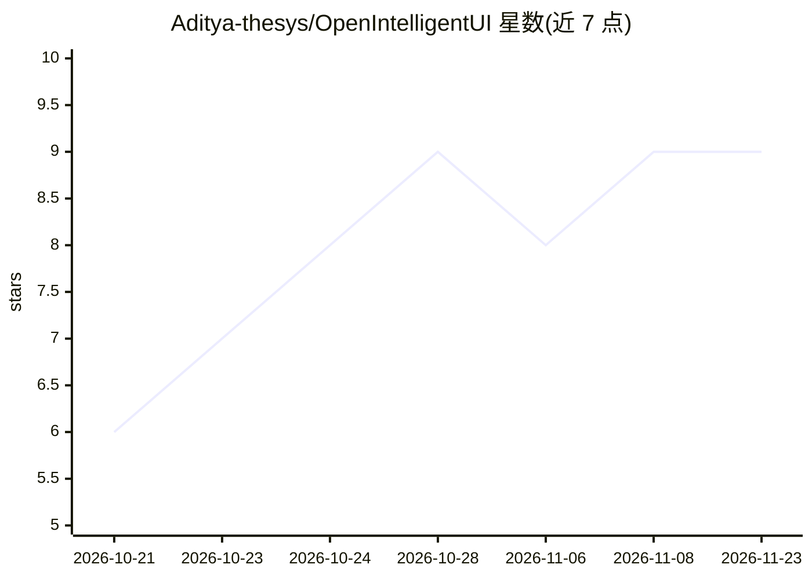

# Aditya-thesys/OpenIntelligentUI

⭐ 9 · TypeScript · MIT · 推送 2026-10-09 · [GitHub](https://github.com/Aditya-thesys/OpenIntelligentUI) · 个人维护

**让模型流式输出可安全渲染的交互 React 界面的开源库**

一套前端库：模型以 Markdown 混合 JSX 式标签和小段 JavaScript 回答，仓库随流式增量编译这些文本，在隐藏 iframe + Web Worker 的沙箱中运行，并用开发者用 zod schema 定义的 React 组件渲染；同一组件定义自动生成教模型使用该语言与组件的系统提示词。安全机制包括移除网络与存储 API、watchdog 重启与 zod 逐属性校验。面向构建 LLM 聊天界面的前端开发者。包尚未发布到 npm，需从源码构建。

## 筛选速览

| 维度 | 判定 | 备注 |
|---|---|---|
| AI 角色 | `ai-ecosystem` | LLM/agent 周边工具 |
| 许可风险 | `permissive` | MIT |
| 部署形态 | `library` | 以包/库形式分发 |
| 模型依赖 | — | README 未给出锁定关系 |
| 硬件要求 | — | 无带数字的原话,不猜 |
| 安装摩擦 | `low` | 无编译、无系统依赖或容器化 |
| 成熟度 | — | 结构信号不足 |

## 能力要点

- 流式边编译边渲染模型生成的 JSX 式界面（图表/计算器/地图/游戏）
- 隐藏 iframe + Web Worker 沙箱：移除网络/存储 API、watchdog 超时重启
- zod schema 逐属性校验，非法属性回退或剔除而非抛错
- 组件定义自动生成系统提示词，支持任意流式 chat completions 模型

## 适用场景

- 为自己的 LLM 聊天应用渲染交互式图表与计算器回答
- 在需要隔离模型生成代码的前端场景中安全运行 UI 程序
- 用自定义 React 组件库对接模型流式输出

## 场景标签

 · 领域:LLM 基础设施/前端 UI

## 证据(README 行号)

> L3: Render model-written interfaces safely while they stream. The model answers with Markdown mixed with JSX-like tags a
> L31: The packages are not on npm yet. Build them from source (see Development).

## 星数曲线

2026-10-21 6 → 2026-11-23 9（+3）

---
*卡片 v1 · prompt 1.4 · 生成 2026-11-20 · 置信度 mid · 依据 README sha `d6ad240515b2` · [字段定义](../../DATASET.md)*
