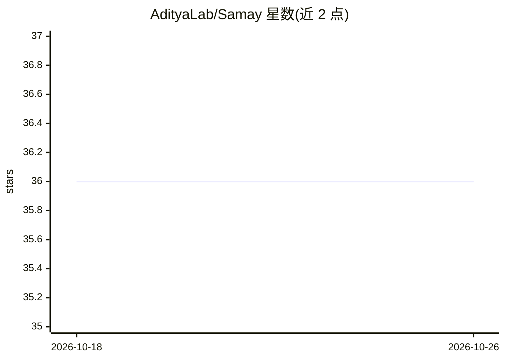

# AdityaLab/Samay

⭐ 36 · Python · Apache-2.0 · 推送 2026-09-19 · [GitHub](https://github.com/AdityaLab/Samay) · [官网](https://adityalab.github.io/SamayDocs) · 组织维护

**时间序列基础模型统一训练与评测库**

Python 包，提供多个时间序列基础模型（LPTM、MOMENT、TimesFM、Chronos、MOIRAI、TinyTimeMixers）的统一加载、数据集封装、训练与零样本预测评测接口。各模型配有对应的 Dataset 类读取 CSV 数据，evaluate 返回损失、真实值与预测值。安装方式为 pip 从 GitHub 仓库安装，另支持克隆后以可编辑模式开发，示例 notebook 在 example 目录提供。引用指向一篇跨领域时间序列预训练模型论文。

## 筛选速览

| 维度 | 判定 | 备注 |
|---|---|---|
| AI 角色 | `ai-native` | 本体是模型或模型工具 |
| 许可风险 | `permissive` | Apache-2.0 |
| 部署形态 | `library` | 以包/库形式分发 |
| 模型依赖 | — | README 未给出锁定关系 |
| 硬件要求 | — | 无带数字的原话,不猜 |
| 安装摩擦 | `low` | 无编译、无系统依赖或容器化 |
| 成熟度 | — | 结构信号不足 |

## 能力要点

- 统一封装 6 个时间序列基础模型的加载与评测接口
- 各模型配套 Dataset 类读取 CSV 时序数据（如 ETTh1）
- 支持零样本预测评测，返回 loss/trues/preds
- 提供示例 notebook 快速上手

## 适用场景

- 我在统一接口下对多个时序基础模型做零样本预测对比
- 我用它加载 LPTM/TimesFM/MOIRAI 等模型在自有 CSV 数据上评测
- 我做时间序列基础模型的训练与开发实验

## 场景标签

`模型评测` `模型训练` · 领域:评测与运维

## 证据(README 行号)

> L3: Package for training and evaluating time-series foundational models.
> L62: avg_loss, trues, preds, histories = lptm.evaluate(val_dataset)
> L116: eval_results, trues, preds, histories = moirai_model.evaluate(test_dataset, metrics=["MSE", "MASE"])

## 星数曲线

2026-10-18 36 → 2026-10-26 36（+0）

---
*卡片 v1 · prompt 1.4 · 生成 2026-10-25 · 置信度 mid · 依据 README sha `7d120c3455ac` · [字段定义](../../DATASET.md)*
