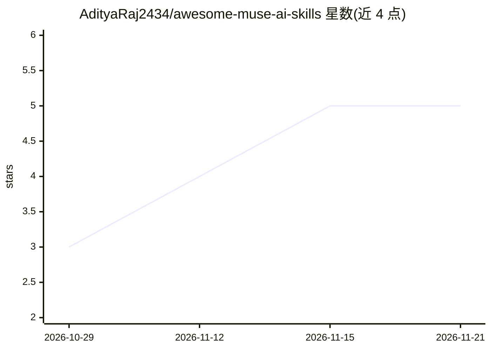

# AdityaRaj2434/awesome-muse-ai-skills

⭐ 5 · MIT · 推送 2026-11-07 · [GitHub](https://github.com/AdityaRaj2434/awesome-muse-ai-skills) · 个人维护

**面向 Muse/Claude 等 agent 的技能策展清单，覆盖视频/语音/3D/工程**

一份收录 agent 技能的聚合清单（描述称 15 个，正文标题称 37 个），按视频动画、语音音频、Web/3D/图表、工程、研究、求职、写作、多 agent 编排、社交发布等类别组织条目。每条给出用途说明与 git clone 或 npx 安装命令；部分条目标注为无公开仓库的本地/自定义技能。列出各技能的前置要求（如本地后端、服务器），并提供安装前后的任务对照示例。面向运行支持技能包的 AI agent 的用户。

## 筛选速览

| 维度 | 判定 | 备注 |
|---|---|---|
| AI 角色 | `ai-knowledge` | 知识聚合/清单类 |
| 许可风险 | `permissive` | MIT |
| 部署形态 | `library` | 以包/库形式分发 |
| 模型依赖 | — | README 未给出锁定关系 |
| 硬件要求 | — | 无带数字的原话,不猜 |
| 安装摩擦 | `medium` | 含编译或系统依赖之一 |
| 成熟度 | — | 结构信号不足 |

## 能力要点

- 按 9 个类别收录 30+ 条技能条目，含安装命令
- 逐条标注是否为 custom/local 技能及是否有公开仓库
- 列出部分技能的依赖要求（本地后端/服务器）
- 提供安装步骤说明（agent skills 文件夹）

## 适用场景

- 为支持技能包的 AI agent 找视频/语音/3D 等领域的现成技能
- 按需复制安装命令将技能装入 agent 的 skills 目录
- 查阅各技能的前置要求后再决定安装

## 场景标签

`精选清单` · 领域:学习与行业

## 证据(README 行号)

> L3: > 37 battle-tested agent skills that turn **Muse AI** from a chatbot into a video studio, voice lab, 3D workshop, re
> L9: ## 📦 The Skills

## 星数曲线

2026-10-29 3 → 2026-11-21 5（+2）

---
*卡片 v1 · prompt 1.4 · 生成 2026-11-21 · 置信度 mid · 依据 README sha `491a0a356aa6` · [字段定义](../../DATASET.md)*
