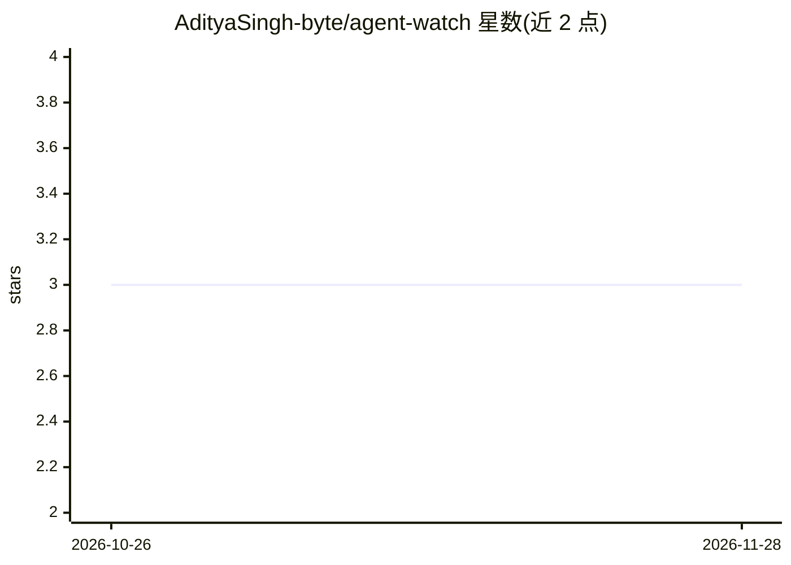

# AdityaSingh-byte/agent-watch

⭐ 3 · TypeScript · MIT · 推送 2026-10-16 · [GitHub](https://github.com/AdityaSingh-byte/agent-watch) · 个人维护

**多 Claude Code 会话统一监控控制台插件**

一个 Claude Code 插件：同时运行多个会话时，在任一会话输入 /watch 打开控制台，查看其余会话的状态（工作/空闲/等待确认）、文件改动、测试结果、问题清单、提交推送、token 消耗与子代理情况；可按 r 键调用模型审查某会话近期工作。/route 开启后按任务类型把子代理任务分派到 haiku/sonnet/opus。工作原理是只读读取 ~/.claude 下的会话与 transcript 文件，数据全部留在本机。

## 筛选速览

| 维度 | 判定 | 备注 |
|---|---|---|
| AI 角色 | `ai-ecosystem` | LLM/agent 周边工具 |
| 许可风险 | `permissive` | MIT |
| 部署形态 | `None` |  |
| 模型依赖 | — | README 未给出锁定关系 |
| 硬件要求 | — | 无带数字的原话,不猜 |
| 安装摩擦 | `medium` | 含编译或系统依赖之一 |
| 成熟度 | — | 结构信号不足 |

## 能力要点

- /watch 终端控制台与 /watch-web 浏览器页展示全部会话状态、文件、测试、token 与子代理
- 按需调用模型审查会话近期活动，列出问题与风险
- /route 按任务需要将子代理任务路由到 haiku/sonnet/opus，失败时建议升档重试
- 增量读取 transcript，超 16MB 只细读末段

## 适用场景

- 同时跑多个 Claude Code 会话时一眼掌握哪些卡住、哪些在等你确认
- 检查会话是否真的跑过测试、推对了分支
- 把查找、常规修改类子任务分派到更小的模型上执行

## 场景标签

`编码 Agent` · 领域:编码与开发

## 证据(README 行号)

> L5: agent-watch is a Claude Code plugin. Run several sessions at once, type `/watch` in any of them, and a console shows
> L100: Every running Claude Code session registers itself in `~/.claude/sessions/` and writes its conversation to a trans

## 星数曲线

2026-10-26 3 → 2026-11-28 3（+0）

---
*卡片 v1 · prompt 1.4 · 生成 2026-11-22 · 置信度 high · 依据 README sha `cd8d844e08b8` · [字段定义](../../DATASET.md)*
