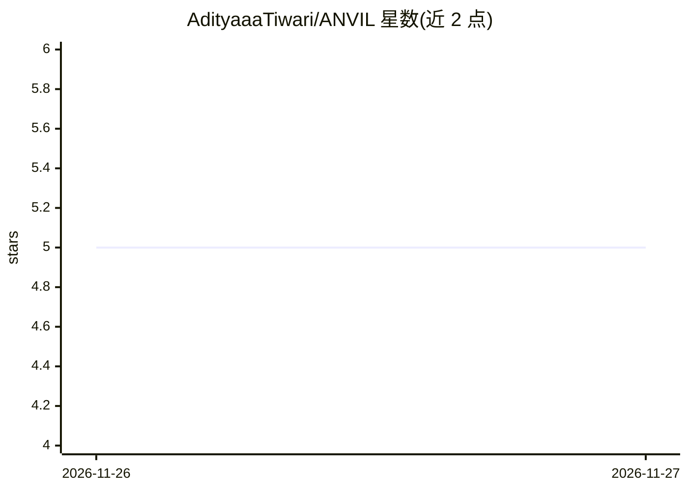

# AdityaaaTiwari/ANVIL

⭐ 5 · TypeScript · NOASSERTION · 推送 2026-11-26 · [GitHub](https://github.com/AdityaaaTiwari/ANVIL) · [官网](https://adityaaatiwari.github.io/ANVIL/) · 个人维护

**为 AI 编码代理提供本地确定性验证与安全门禁的工程工作台**

ANVIL 定位为 AI 编码代理的本地确定性验证与安全层：通过 6 阶段验证循环（Plan/Guard/Build/Verify/Prove/Learn）拦截代理在测试失败时删除测试、插入 skip 标记等造假行为，用 git 校验和与 SHA-256 凭据证明结果。提供只读 MCP 服务器压缩架构上下文、带 SARIF 输出的 CI 质量与安全门禁、秘密扫描、变更爆炸半径分析、多代理竞速等命令。以 npm 包与 CLI 分发，面向使用 AI 辅助交付的工程团队。

## 筛选速览

| 维度 | 判定 | 备注 |
|---|---|---|
| AI 角色 | `ai-ecosystem` | LLM/agent 周边工具 |
| 许可风险 | `none` | NOASSERTION |
| 部署形态 | `library` | 以包/库形式分发 |
| 模型依赖 | — | README 未给出锁定关系 |
| 硬件要求 | — | 无带数字的原话,不猜 |
| 安装摩擦 | `low` | 无编译、无系统依赖或容器化 |
| 成熟度 | — | 结构信号不足 |

## 能力要点

- 6 阶段验证循环检测测试删除/跳过等代理造假并以 needs-review 阻断
- 本地只读 MCP 服务器在 <1.5k token 内提供架构摘要与循环依赖图
- anvil gate 提供带 SARIF 输出的确定性 CI 质量与策略门禁
- 内置 49 个专家代理、76 技能、34 命令、26 规则集的目录

## 适用场景

- 在合并前核验 AI 代理生成的改动是否真实通过测试
- CI/PR 中强制执行质量、秘密泄漏与策略检查
- 为编码代理提供低 token 的仓库架构上下文
- 在同一任务上竞速对比多个编码代理的产出

## 场景标签

`代码审查` · 领域:编码与开发

## 证据(README 行号)

> L22: **ANVIL** is a local-first, deterministic **verification and safety layer** for AI coding agents.
> L135: |`anvil mcp [setup\|start\|sync]`|Configures, runs, or cross-syncs the local Model Context Protocol server|`add`, 

## 星数曲线

2026-11-26 5 → 2026-11-27 5（+0）

---
*卡片 v1 · prompt 1.4 · 生成 2026-11-26 · 置信度 high · 依据 README sha `34327cd1f1c3` · [字段定义](../../DATASET.md)*
