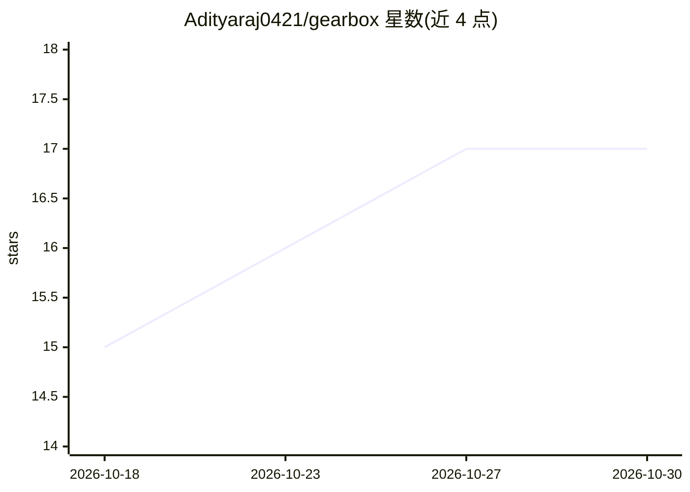

# Adityaraj0421/gearbox

⭐ 17 · Python · MIT · 推送 2026-10-09 · [GitHub](https://github.com/Adityaraj0421/gearbox) · 个人维护

**Claude Code 插件：按任务分级路由子代理模型以控制成本**

Claude Code 插件，将子代理委派自动路由到不同模型层级：haiku 负责搜索与机械编辑，sonnet 负责标准实现，opus 负责架构难题。提供升级阶梯（便宜层级卡住时逐级升级）、独立验证器（haiku 在接受结果前审查 diff、检查 gaming 模式）以及 JSONL 遥测（记录每次委派的层级、命名代理/代理分派、验证裁决与升级）。通过 Claude Code 斜杠命令安装，SessionStart 钩子注入路由策略。已知限制包括脏文件盲区、策略注入约 2.5KB 上下文开销等。

## 筛选速览

| 维度 | 判定 | 备注 |
|---|---|---|
| AI 角色 | `ai-ecosystem` | LLM/agent 周边工具 |
| 许可风险 | `permissive` | MIT |
| 部署形态 | `None` |  |
| 模型依赖 | locked-api |  |
| 硬件要求 | — | 无带数字的原话,不猜 |
| 安装摩擦 | `low` | 无编译、无系统依赖或容器化 |
| 成熟度 | `idea` | |

## 能力要点

- 三级模型层级路由（haiku/sonnet/opus）加升级阶梯与硬性下限
- 独立验证器基于 BASELINE git 快照审查 T1/T2 改动、识别 gaming 模式
- JSONL 遥测记录每次委派的层级、命名代理分派、裁决与升级
- 可用 /gearbox:init 生成项目本地路由策略自定义阈值

## 适用场景

- 降低 Claude Code 子代理委派的模型成本
- 在架构级任务上自动使用高层级模型并防止低层级误派
- 通过遥测日志度量实际路由行为与升级频率

## 场景标签

`模型网关` · 领域:Agent 开发

## 证据(README 行号)

> L5: Claude Code plugin
> L8: Gearbox is a Claude Code plugin that automatically routes subagent delegations to the cheapest model tier that can h

## 星数曲线

2026-10-18 15 → 2026-10-30 17（+2）

---
*卡片 v1 · prompt 1.4 · 生成 2026-10-30 · 置信度 high · 依据 README sha `b051b49fb5ba` · [字段定义](../../DATASET.md)*
