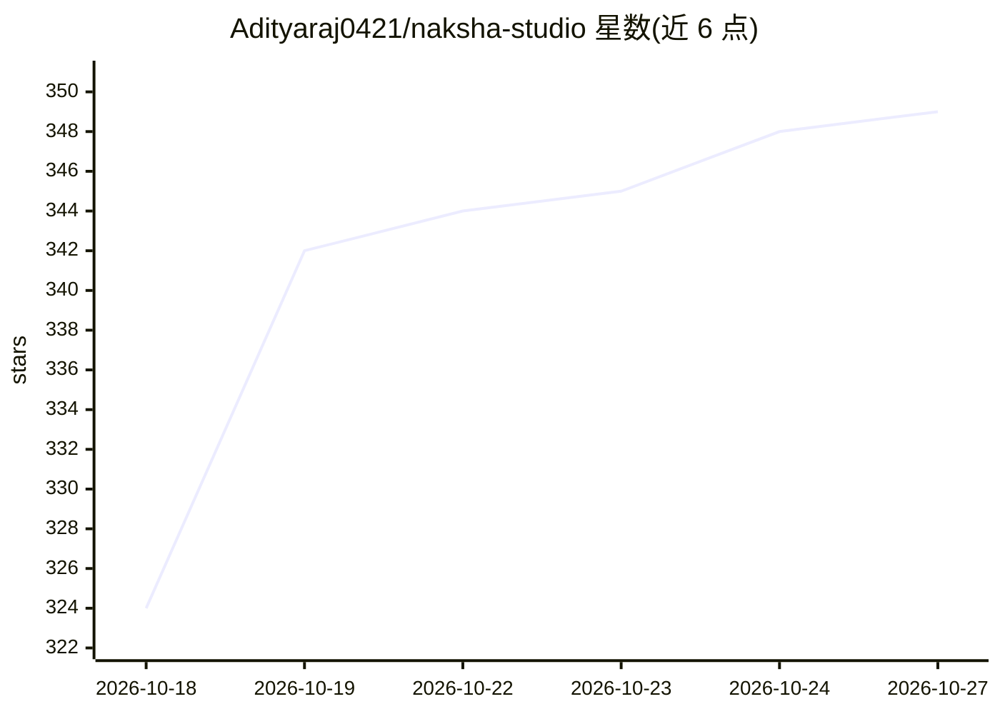

# Adityaraj0421/naksha-studio

⭐ 349 · JavaScript · MIT · 推送 2026-10-18 · [GitHub](https://github.com/Adityaraj0421/naksha-studio) · [官网](https://github.com/Adityaraj0421/naksha-studio/releases/latest) · 个人维护

**面向 AI 编码 CLI 的虚拟设计团队插件（30 角色、70 命令）**

以 Claude Code 插件形式提供的设计知识包：包含 30 个设计专家角色、70 个斜杠命令与约 16,000 行设计知识，覆盖设计审查、Figma 转码、设计系统 token、无障碍审计、邮件模板、社媒内容、AI 图像/视频/音频提示等场景；按任务自动加载所需角色与参考。同时以规则文件/技能目录形式支持 Cursor、Windsurf、Gemini CLI、VS Code Copilot 与 Autohand Code CLI。Claude Code 可经 marketplace 安装，其余编辑器通过复制配置文件接入。

## 筛选速览

| 维度 | 判定 | 备注 |
|---|---|---|
| AI 角色 | `ai-knowledge` | 知识聚合/清单类 |
| 许可风险 | `permissive` | MIT |
| 部署形态 | `None` |  |
| 模型依赖 | locked-api |  |
| 硬件要求 | — | 无带数字的原话,不猜 |
| 安装摩擦 | `low` | 无编译、无系统依赖或容器化 |
| 成熟度 | — | 结构信号不足 |

## 能力要点

- 30 个设计专家角色按任务自动激活
- 70 个命令覆盖设计审查、Figma 双向转换、token 管理、无障碍与合规审计等
- 约 16,000 行设计知识，仅加载任务所需参考
- 项目记忆与 taste memory 机制持久化设计偏好

## 适用场景

- 在 Claude Code 中用 /design 命令完成完整设计工作流
- 将 Figma 设计转换为生产代码并检测设计-代码偏差
- 为团队生成和审计设计系统 token 与无障碍合规

## 场景标签

`提示工程` · 领域:Agent 开发

## 证据(README 行号)

> L5: *The Naksha design team, inside your terminal — 30 specialist roles activate automatically based on what you're buil
> L193: _The skill loads only the references your task actually needs_

## 星数曲线

2026-10-18 324 → 2026-10-27 349（+25）

---
*卡片 v1 · prompt 1.4 · 生成 2026-10-21 · 置信度 high · 依据 README sha `851d422c01ac` · [字段定义](../../DATASET.md)*
