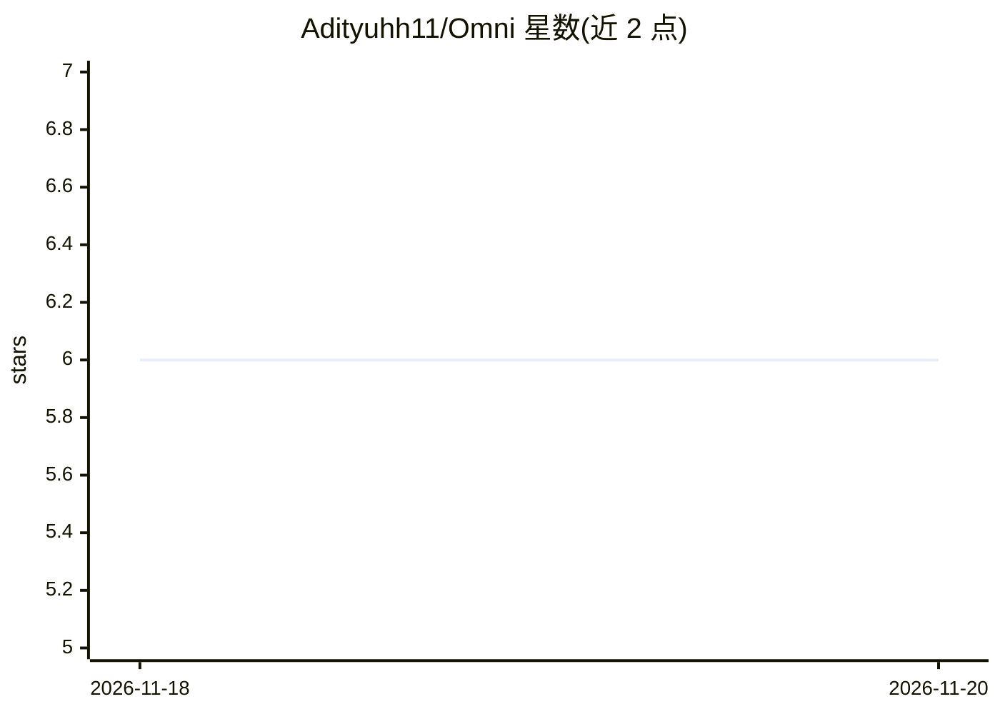

# Adityuhh11/Omni

⭐ 6 · Go · MIT · 推送 2026-11-17 · [GitHub](https://github.com/Adityuhh11/Omni) · 个人维护

**本地运行的 Windows/Mac 启动器：开应用、按语义找文件、问本地 AI**

以快捷键唤起的桌面启动器，功能包括应用检索、剪贴板历史、片段与笔记、计时器、日历、计算与系统命令；可选开启按内容含义检索文件（代码、PDF、笔记、图片、音频所说内容），以及 `ask:` 与本机模型对话的 Omni AI，可把文件、笔记、日历和网络作为工具。默认不联网、无遥测与账户，搜索引擎与模型下载均校验 SHA-256；文件搜索与 AI 需手动开启并下载约 1 GB 资源。Windows 提供安装包，macOS 提供脚本安装。

## 筛选速览

| 维度 | 判定 | 备注 |
|---|---|---|
| AI 角色 | `ai-enhanced` | 去掉 AI 部分产品仍成立 |
| 许可风险 | `permissive` | MIT |
| 部署形态 | `desktop` | 安装包/桌面程序 |
| 模型依赖 | local-ok | 支持本地模型 |
| 硬件要求 | — | 无带数字的原话,不猜 |
| 安装摩擦 | `low` | 无编译、无系统依赖或容器化 |
| 成熟度 | `idea` | |

## 能力要点

- 热键唤起，中位约 33 ms 绘出输入框，不等待模型
- 按内容含义检索文件（图片、代码、PDF、音频所说内容）
- Omni AI 使用本机模型（llama.cpp），也可接 LM Studio/Ollama 或自备 key 的服务
- 无遥测与账户，引擎与模型仅监听 127.0.0.1

## 适用场景

- 用一个快捷键快速打开应用与执行系统命令
- 用自然语言描述找到本地照片或文件
- 在本机上与文件、笔记为上下文的模型对话
- 把本地数据作为工具接入 Claude Desktop、Cursor 等 AI 应用

## 场景标签

`知识库管理` `语义搜索` · 领域:知识与检索

## 证据(README 行号)

> L3:  A fast, private launcher for Windows and Mac.
> L43: - **Files, by meaning** *(optional)*: code, PDF pages, notes, photos by what they show, videos, and what is said in
> L44: - **Omni AI** *(optional)*: `ask:` chats with a model on your computer, or with LM Studio, Ollama or a service with

## 星数曲线

2026-11-18 6 → 2026-11-20 6（+0）

---
*卡片 v1 · prompt 1.4 · 生成 2026-11-20 · 置信度 mid · 依据 README sha `3dce033dbd9c` · [字段定义](../../DATASET.md)*
