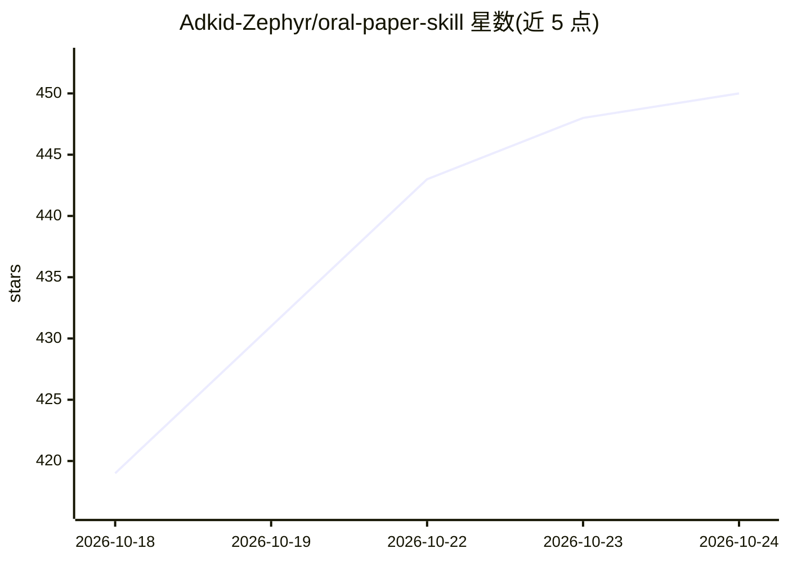

# Adkid-Zephyr/oral-paper-skill

⭐ 451 · Python · 推送 2026-09-17 · [GitHub](https://github.com/Adkid-Zephyr/oral-paper-skill) · 个人维护 · 中文 README

**从 883 篇顶会 Oral 论文提炼写作方法的 Skill 与提示词包**

面向科研人员的论文学习 Skill + 中英双语提示词包：以 ICLR/ICML/NeurIPS 近两个周期共 883 篇 Oral 论文摘要为材料，经提取、比较与综合筛出七项共通做法（写清研究张力、明确贡献增量、让证据对应主张等）。使用方式为复制提示词或将 skills 目录放入 Codex/Claude 类工具，提供两项功能：对照优秀论文指出稿件可改进处，以及讲解优秀做法指导复盘。归因某篇论文时需读取对应原文；效果未经独立对照评测，也不保证录取。

## 筛选速览

| 维度 | 判定 | 备注 |
|---|---|---|
| AI 角色 | `ai-knowledge` | 知识聚合/清单类 |
| 许可风险 | `none` | — |
| 部署形态 | `None` |  |
| 模型依赖 | — | README 未给出锁定关系 |
| 硬件要求 | — | 无带数字的原话,不猜 |
| 安装摩擦 | `low` | 无编译、无系统依赖或容器化 |
| 成熟度 | — | 结构信号不足 |

## 能力要点

- 覆盖 ICLR/ICML/NeurIPS 六个周期共 883 篇 Oral 论文摘要的逐篇记录
- 提炼出七项可复用做法，每条建议含出处→相关原因→稿件现状→具体改法
- Skill + 中英双语提示词两种形态，git clone 后放入 ~/.codex/skills/ 或 ~/.claude/skills/

## 适用场景

- 投稿前对照往届 Oral 论文找出稿件最值得改进的地方
- 学习优秀论文的叙事推进与实验设计并做复盘
- 判断某项论文做法是否适用于自己的工作

## 场景标签

`提示工程` `科研工具` · 领域:Agent 开发

## 证据(README 行号)

> L28: 这里的“蒸馏”指知识提炼：从论文中整理具体做法、适用条件和例子，写成 Skill。这轮从摘要逐篇提取，再比较、核查与综合；涉及正文或图表的建议，需要另外阅读对应材料。
> L99: 统计已排除 workshop 活动等非论文条目。这 883 篇论文的摘要均已形成逐篇语义记录，并完成 21 组综合，最终筛选出七项做法。

## 星数曲线

2026-10-18 419 → 2026-10-24 450（+31）

---
*卡片 v1 · prompt 1.4 · 生成 2026-10-21 · 置信度 high · 依据 README sha `38f41589b6fb` · [字段定义](../../DATASET.md)*
