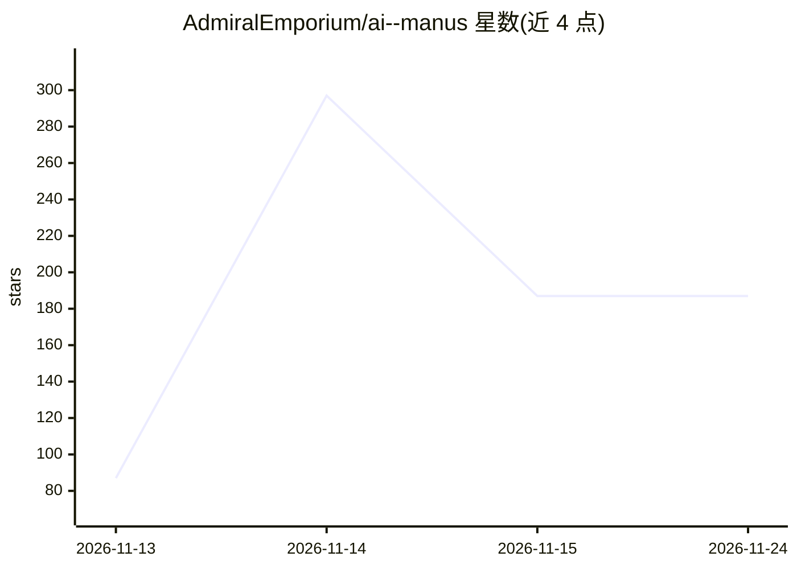

# AdmiralEmporium/ai--manus

⭐ 187 · Apache-2.0 · 推送 2026-11-15 · [GitHub](https://github.com/AdmiralEmporium/ai--manus) · 个人维护

**面向个人用户的自主 AI Agent：自动执行代码与控制浏览器**

自称 Manus 的自主 AI Agent，宣传卖点是代替用户执行代码脚本、控制浏览器（导航网页、填表、采集信息）并完成多步骤日常任务，定位为家庭、学习与轻量办公场景的个人助手，而非企业平台。README 以功能描述和使用建议为主，提到沙箱环境运行工具，但未给出任何安装命令、代码仓库结构、模型接入方式或架构细节，仅列出硬件兼容表与六步上手流程；页面含‘Download Manus / PROMO2026’推广字样，技术内容可验证信息有限。

## 筛选速览

| 维度 | 判定 | 备注 |
|---|---|---|
| AI 角色 | `ai-native` | 本体是模型或模型工具 |
| 许可风险 | `permissive` | Apache-2.0 |
| 部署形态 | `None` |  |
| 模型依赖 | — | README 未给出锁定关系 |
| 硬件要求 | — | 无带数字的原话,不猜 |
| 安装摩擦 | `low` | 无编译、无系统依赖或容器化 |
| 成熟度 | — | 结构信号不足 |

## 能力要点

- 自主执行代码脚本完成多步骤任务
- 浏览器控制：导航网页、填表、信息采集
- 面向家庭/学习/轻量办公的个人助手定位

## 适用场景

- 让 agent 代为完成重复性的网页操作与数据整理
- 学生组织研究笔记、运行小脚本
- 远程工作者从多个页面收集信息生成小结

## 场景标签

`AI 助手` `浏览器自动化` · 领域:效率与自动化

## 证据(README 行号)

> L10: - **Autonomous Code Execution:** Manus AI agent runs code on its own to complete tasks, so you can focus on decisio
> L18: Manus is an autonomous AI agent designed to run code and control a browser on your behalf. Instead of acting like a

## 星数曲线

2026-11-13 87 → 2026-11-24 187（+100）

---
*卡片 v1 · prompt 1.4 · 生成 2026-11-17 · 置信度 low · 依据 README sha `0f78ee3a5dd2` · [字段定义](../../DATASET.md)*
