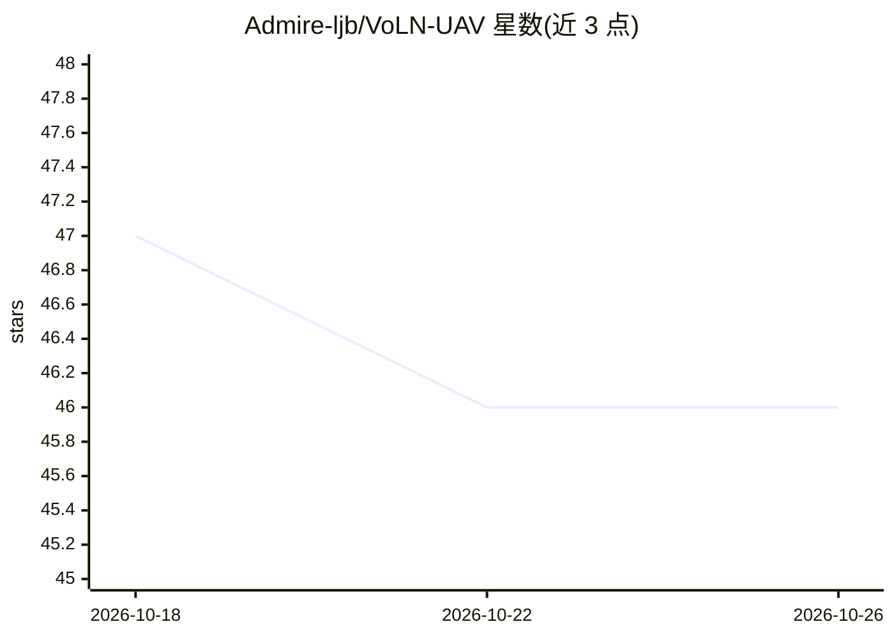

# Admire-ljb/VoLN-UAV

⭐ 46 · Python · MIT · 推送 2026-08-04 · [GitHub](https://github.com/Admire-ljb/VoLN-UAV) · 组织维护 · 中文 README

**视觉长时程无人机导航的基准与 VoLN-MLLM 智能体官方代码**

论文 VoLN（Vision-Only Long-Horizon Navigation）的官方复现代码库：提供 VoLN-MLLM 适配器与规划器训练、Seq2Seq-VG/CMA-VG/LAG-VG 基线、AirSim 闭环评测、三项消融实验及 NE/SR/OSR/nDTW/SPL 等指标报告。方法上用轻量适配器将冻结 DINOv3 特征蒸馏到 CLIP 空间，冻结 Vicuna-7B-v1.5 骨干配合 Rank-16 LoRA 预测 8 个机体系相对 3D 航点与停止信号。数据集与模拟器环境单独发布，当前公开 1,786 episodes（完整 7,210 episodes 计划中）。以 Python 包 + 脚本形式提供，面向科研复现。

## 筛选速览

| 维度 | 判定 | 备注 |
|---|---|---|
| AI 角色 | `ai-native` | 本体是模型或模型工具 |
| 许可风险 | `permissive` | MIT |
| 部署形态 | `library` | 以包/库形式分发 |
| 模型依赖 | — | README 未给出锁定关系 |
| 硬件要求 | — | 无带数字的原话,不猜 |
| 安装摩擦 | `medium` | 含编译或系统依赖之一 |
| 成熟度 | — | 结构信号不足 |

## 能力要点

- 两阶段方法：DINOv3→CLIP 视觉语义对齐 + Vicuna-7B LoRA 轨迹规划
- AirSim 闭环评测与 NE/SR/OSR/nDTW/SPL/CT/EER 指标报告
- 含 No-Align / No-LoRA / CLIP-Input 三项消融实验
- 提供真值轨迹回放（ground-truth replay）诊断工具

## 适用场景

- 复现论文训练与 AirSim 评测流程
- 在视觉目标长时程无人机导航基准上对比基线方法
- 运行消融实验验证各模块贡献

## 场景标签

`模型评测` `科研工具` `多模态` · 领域:评测与运维

## 证据(README 行号)

> L27: - VoLN-MLLM adapter and planner training;
> L59: 1. **Visual-semantic alignment.** A lightweight adapter maps frozen DINOv3 ViT-B/16 features into the frozen CLIP V

## 星数曲线

2026-10-18 47 → 2026-10-26 46（-1）

---
*卡片 v1 · prompt 1.4 · 生成 2026-10-25 · 置信度 high · 依据 README sha `fe012ff4dc94` · [字段定义](../../DATASET.md)*
