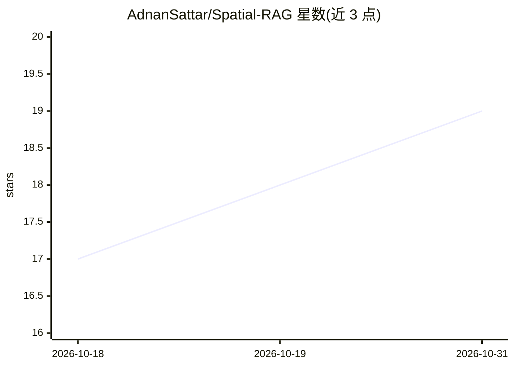

# AdnanSattar/Spatial-RAG

⭐ 19 · Python · MIT · 推送 2025-12-02 · [GitHub](https://github.com/AdnanSattar/Spatial-RAG) · 个人维护

**面向地理空间文档的空间增强 RAG 全栈系统**

结合语义检索与空间邻近度的全栈 RAG 系统：FastAPI 后端用 BGE-small 本地嵌入做语义相似度，PostGIS + pgvector 做地理空间查询，按可调权重 α/β 混合打分排序，再由 LLM（OpenAI API，可选，留空则 mock）生成回答，支持 SSE 流式输出。前端为 Next.js 14 + Leaflet 交互地图。Docker Compose 一键启动，内置合成数据生成器（1000+ 空间文档）。适用于分区法规、建筑许可等带地理约束的查询场景。

## 筛选速览

| 维度 | 判定 | 备注 |
|---|---|---|
| AI 角色 | `ai-ecosystem` | LLM/agent 周边工具 |
| 许可风险 | `permissive` | MIT |
| 部署形态 | `self-host` | docker 或自建部署 |
| 模型依赖 | — | README 未给出锁定关系 |
| 硬件要求 | — | 无带数字的原话,不猜 |
| 安装摩擦 | `low` | 无编译、无系统依赖或容器化 |
| 成熟度 | — | 结构信号不足 |

## 能力要点

- BGE 本地嵌入（384 维）与 PostGIS 空间查询混合检索
- 可调权重的 hybrid_score = α×语义 + β×空间 排序
- SSE 流式 LLM 回答生成，OpenAI key 可选（留空走 mock）
- Docker Compose 一键启动 PostGIS+pgvector+FastAPI+Next.js 全栈

## 适用场景

- 查询某地点指定半径内的分区限制或环境法规
- 在地图上可视化检索到的空间文档并获取 AI 生成回答
- 生成合成空间数据集做空间 RAG 原型开发与测试

## 场景标签

`RAG` `文档问答` · 领域:知识与检索

## 证据(README 行号)

> L13: Spatial-RAG extends classic RAG by adding a spatial retrieval layer that enforces geographic constraints before or 
> L21: - **🌍 Hybrid Spatial-Semantic Retrieval**: Combines BGE embeddings (semantic similarity) with PostGIS spatial queri

## 星数曲线

2026-10-18 17 → 2026-10-31 19（+2）

---
*卡片 v1 · prompt 1.4 · 生成 2026-10-29 · 置信度 mid · 依据 README sha `3e3e6c4446d1` · [字段定义](../../DATASET.md)*
