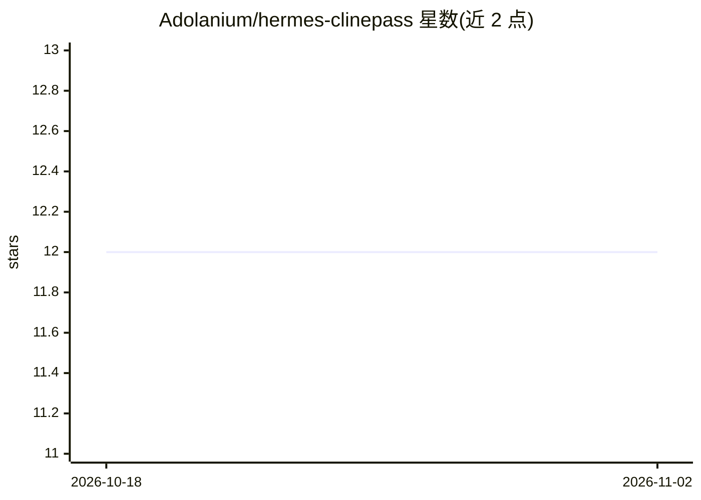

# Adolanium/hermes-clinepass

⭐ 12 · Python · MIT · 推送 2026-10-17 · [GitHub](https://github.com/Adolanium/hermes-clinepass) · [官网](https://github.com/Adolanium/hermes-clinepass) · 个人维护

**让 Hermes Agent 通过 ClinePass 调用 Kimi/GLM/DeepSeek 等模型的插件**

面向 Hermes Agent 的模型提供商插件：将 ClinePass 订阅下的 cline-pass/* 模型（Kimi K3、GLM、DeepSeek 等）注册为 Hermes 可用的 provider，仅需普通 API key 即可调用。模型发现机制为读取 Cline 在线目录的 clinePass 与 free 块，与 Cline 自身的 ClinePass 选择器保持一致；在线刷新失败时回退到内置精选表。内置表仅含 pass 模型，因免费模型会轮换。需注意非流式调用（标题/摘要/压缩等辅助任务）依赖 Hermes 核心 issue 的修复。提供 shell 一键脚本、手动复制与 pip 三种安装方式。

## 筛选速览

| 维度 | 判定 | 备注 |
|---|---|---|
| AI 角色 | `ai-ecosystem` | LLM/agent 周边工具 |
| 许可风险 | `permissive` | MIT |
| 部署形态 | `library` | 以包/库形式分发 |
| 模型依赖 | — | README 未给出锁定关系 |
| 硬件要求 | — | 无带数字的原话,不猜 |
| 安装摩擦 | `low` | 无编译、无系统依赖或容器化 |
| 成熟度 | — | 结构信号不足 |

## 能力要点

- 将 cline-pass/* 模型注册为 Hermes 的 provider，含 15 个内置回退模型条目
- 读取 Cline 在线目录的 clinePass 与 free 块，新模型无需插件更新即可出现
- 支持 provider 别名 clinepass/cline-pass/cline，默认辅助模型为 deepseek-v4-flash
- 同一 host 与 key 也可用 OpenRouter 风格的用量计费模型 ID

## 适用场景

- 在 Hermes Agent 中使用已订阅的 ClinePass 模型
- 通过 hermes chat 命令直接调用 Kimi/GLM/DeepSeek 等模型
- 让 Hermes 的模型选择器自动发现 ClinePass 目录中的新模型

## 场景标签

`模型网关` · 领域:Agent 开发

## 证据(README 行号)

> L3: ClinePass model-provider plugin for Hermes Agent.
> L5: Use ClinePass models (`cline-pass/*`) from Hermes with a normal API key. Includes Kimi K3, GLM, DeepSeek, and the re

## 星数曲线

2026-10-18 12 → 2026-11-02 12（+0）

---
*卡片 v1 · prompt 1.4 · 生成 2026-11-01 · 置信度 high · 依据 README sha `b63fa29f23f4` · [字段定义](../../DATASET.md)*
