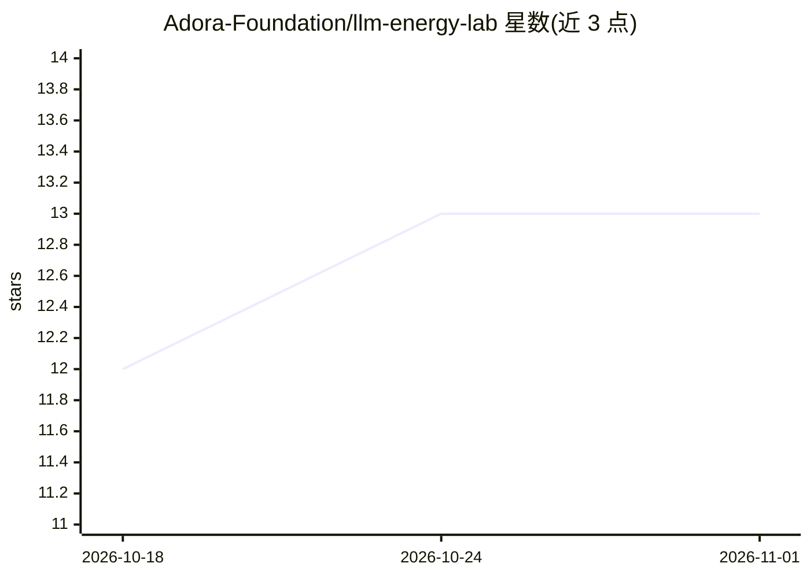

# Adora-Foundation/llm-energy-lab

⭐ 13 · Python · 推送 2025-12-11 · [GitHub](https://github.com/Adora-Foundation/llm-energy-lab) · 组织维护

**测量与比较 LLM 推理能耗、排放与行为的 Web 基准平台**

面向研究与工程团队的 Web 应用与 API：在云与裸机环境下，对不同推理配置、中间件注入与后训练实现进行 LLM 能耗与行为基准测试。核心机制包括 Linux/Intel RAPL 实时功耗测量（区分 Prefill 与 Decode 阶段）、Wh/1000 能耗加权 token（e-tokens）指标、CO2 估算，以及多模型并排行为对比 UI。推理默认经本地 Ollama 执行，可选 Groq 云 API。限制：实时功耗监测需 Linux 内核 RAPL 支持，无 RAPL 时降级为基准估算；版本 0.1.0，行为实验室标注为进行中。

## 筛选速览

| 维度 | 判定 | 备注 |
|---|---|---|
| AI 角色 | `ai-ecosystem` | LLM/agent 周边工具 |
| 许可风险 | `none` | — |
| 部署形态 | `self-host` | docker 或自建部署 |
| 模型依赖 | local-ok | 支持本地模型 |
| 硬件要求 | — | 无带数字的原话,不猜 |
| 安装摩擦 | `low` | 无编译、无系统依赖或容器化 |
| 成熟度 | `idea` | |

## 能力要点

- RAPL 实时功耗测量，按快照分离 Prefill/Decode 能耗（Wh/1K）
- e-tokens 能耗加权指标：将总能耗摊销到每 1000 输入/输出 token
- 中间件注入（系统提示、会话上下文、自由注入）与 token 分类分析
- 多模型并排对比 UI，含流式输出、token 计数与 TPS

## 适用场景

- 测量不同提示注入与配置下本地模型的能耗与碳排放
- 比较多模型/多温度下的输出行为与变异性
- 寻找 prefill 与 decode 能耗的经验交叉点

## 场景标签

`模型评测` · 领域:评测与运维

## 证据(README 行号)

> L7: The **LLM Energy Lab ** is a web application and API for benchmarking and comparing LLM energy consumption, emission
> L61:  - **Energy and behaviour analysis modules** wrap inference to:

## 星数曲线

2026-10-18 12 → 2026-11-01 13（+1）

---
*卡片 v1 · prompt 1.4 · 生成 2026-10-31 · 置信度 mid · 依据 README sha `453f17b3a8a1` · [字段定义](../../DATASET.md)*
