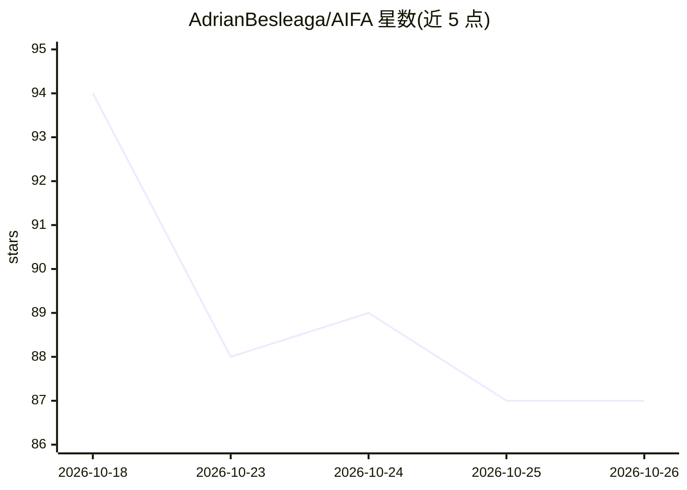

# AdrianBesleaga/AIFA

⭐ 87 · 推送 2026-10-20 · [GitHub](https://github.com/AdrianBesleaga/AIFA) · [官网](https://adrianbesleaga.github.io/AIFA/) · 个人维护

**AI 原生全栈应用架构方法论：以可执行功能契约为核心组织人与 AI 协作开发**

AIFA 是一套软件架构方法论与规范：将每个业务用例组织为独立的功能切片（feature slice），以机器可读的 feature.definition.json 契约声明用途、输入输出、权限、能力依赖、UI 插槽与验收标准，由运行时统一为浏览器 HTTP 与 MCP/AI 客户端执行同一业务路径，并通过 JSON Schema 校验、依赖边界检查、Gherkin 可执行验收场景等护栏机制约束人类开发者与编码 Agent。文档定位为对垂直切片、Clean/Hexagonal 等既有架构的补充而非替代；不适用于小型原型或单人维护项目。另附 Focusly（AI 待办助手）作为参考实现。

## 筛选速览

| 维度 | 判定 | 备注 |
|---|---|---|
| AI 角色 | `ai-knowledge` | 知识聚合/清单类 |
| 许可风险 | `none` | — |
| 部署形态 | `self-host` | docker 或自建部署 |
| 模型依赖 | local-ok | 支持本地模型 |
| 硬件要求 | — | 无带数字的原话,不猜 |
| 安装摩擦 | `low` | 无编译、无系统依赖或容器化 |
| 成熟度 | — | 结构信号不足 |

## 能力要点

- 机器可读功能契约（feature.definition.json）集中声明用途、安全、能力与验收标准
- HTTP 与 MCP 走同一功能运行时，浏览器与 AI 客户端遵循相同业务规则
- 可执行护栏：JSON Schema、依赖边界检查、Gherkin 验收场景与 MCP/HTTP 一致性测试
- 与 Layered、Clean/Hexagonal、Vertical Slice 等架构的逐项对照说明

## 适用场景

- 人类开发者与 AI 编码 Agent 共同维护代码库时限定变更边界
- 为多入口（浏览器/HTTP/MCP）操作提供单一治理的业务逻辑路径
- 按 BDD 流程先约定 Gherkin 业务规则再实现功能

## 场景标签

 · 领域:软件工程/架构方法论

## 证据(README 行号)

> L3: **AIFA is an AI-native software architecture for building full-stack applications from small, explicit, independentl
> L158: ## Reference implementation: Focusly

## 星数曲线

2026-10-18 94 → 2026-10-26 87（-7）

---
*卡片 v1 · prompt 1.4 · 生成 2026-10-23 · 置信度 low · 依据 README sha `e8289f5bac7f` · [字段定义](../../DATASET.md)*
