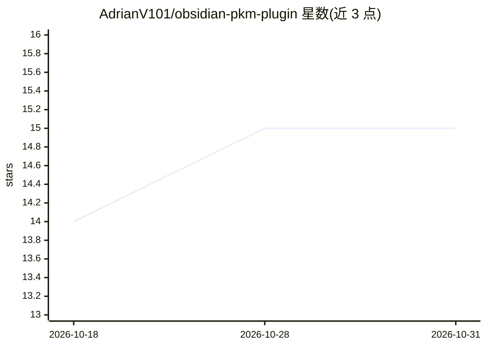

# AdrianV101/obsidian-pkm-plugin

⭐ 15 · JavaScript · MIT · 推送 2026-10-27 · [GitHub](https://github.com/AdrianV101/obsidian-pkm-plugin) · [官网](https://www.npmjs.com/package/obsidian-pkm) · 个人维护

**把 Obsidian 库变成 Claude Code 持久知识库的 MCP 插件**

发布于 npm（obsidian-pkm）的 Claude Code 插件，通过 20 个 MCP 工具让 Claude 读写、搜索、遍历 Obsidian 库：模板化建笔记（13 种、带 frontmatter 校验）、全文与语义检索（OpenAI embeddings + sqlite-vec）、wikilink 图遍历与链接健康审计、跨会话活动日志，另有 3 个 agent、6 个 skill、2 个命令。面向使用 Claude Code 且用 Obsidian 管理知识的开发者。语义搜索需 OpenAI key，依赖 Node.js ≥ 20（预编译二进制覆盖主流平台）。

## 筛选速览

| 维度 | 判定 | 备注 |
|---|---|---|
| AI 角色 | `ai-ecosystem` | LLM/agent 周边工具 |
| 许可风险 | `permissive` | MIT |
| 部署形态 | `library` | 以包/库形式分发 |
| 模型依赖 | — | README 未给出锁定关系 |
| 硬件要求 | — | 无带数字的原话,不猜 |
| 安装摩擦 | `medium` | 含编译或系统依赖之一 |
| 成熟度 | — | 结构信号不足 |

## 能力要点

- 20 个 MCP 工具覆盖笔记创建、语义搜索、图遍历、元数据查询与会话记忆
- 13 种带 frontmatter 校验的笔记模板与 PARA 目录脚手架（npx obsidian-pkm init）
- 3 个后台 agent（explorer/capture/auditor）自动完成知识捕获与链接审计
- 语义搜索基于 OpenAI text-embedding-3-large + SQLite/sqlite-vec 本地索引

## 适用场景

- 让 Claude Code 在多项目间共享一个 Obsidian 知识库
- 用对话创建和管理 ADR、研究笔记、任务等结构化笔记
- 对已有 vault 做语义搜索、图谱探索与链接健康审计

## 场景标签

`知识库管理` `语义搜索` · 领域:知识与检索

## 证据(README 行号)

> L12: Give Claude persistent, structured memory across conversations using your Obsidian vault. Read, write, search, and 
> L14: Under the hood, this Claude Code plugin provides 20 MCP (Model Context Protocol) tools for note creation, semantic 
> L131: - **Node.js >= 20** (Node 18 is EOL; uses native `fetch` and ES modules)

## 星数曲线

2026-10-18 14 → 2026-10-31 15（+1）

---
*卡片 v1 · prompt 1.4 · 生成 2026-10-31 · 置信度 high · 依据 README sha `9d95c84440d0` · [字段定义](../../DATASET.md)*
