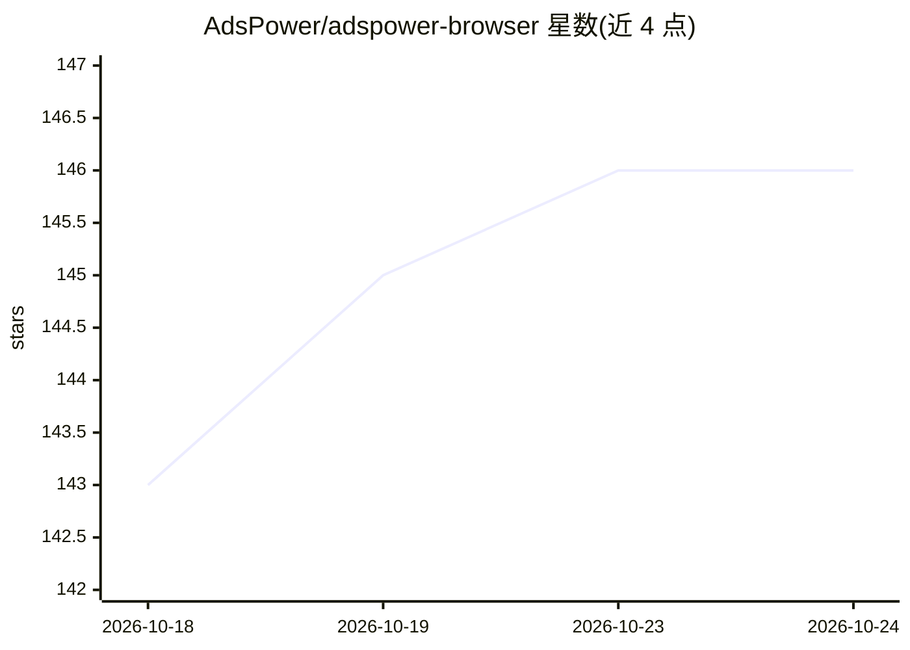

# AdsPower/adspower-browser

⭐ 146 · TypeScript · MIT · 推送 2026-10-22 · [GitHub](https://github.com/AdsPower/adspower-browser) · [官网](https://www.adspower.com/) · 组织维护 · 中文 README

**AdsPower 反指纹浏览器的 Skill/MCP/CLI 接入工具包**

AdsPower 官方为 Local API 提供的三件套接入工具：Skill 包（可装入 Claude Code/Codex/Cursor/OpenCode/OpenClaw/Hermes 等 agent 客户端）、MCP 服务器（local-api-mcp-typescript，通过端口与 API key 连接 AdsPower Local API，默认端口 50325）、以及独立运行的 CLI（不与 AdsPower 客户端共享缓存/内核，支持 headless 模式）。要求本机安装 AdsPower 客户端与 Node 18+，部分 API 依赖客户端版本，未升级可能返回 Not found。提供 Docker 方式运行 CLI。

## 筛选速览

| 维度 | 判定 | 备注 |
|---|---|---|
| AI 角色 | `ai-ecosystem` | LLM/agent 周边工具 |
| 许可风险 | `permissive` | MIT |
| 部署形态 | `desktop` | 安装包/桌面程序 |
| 模型依赖 | — | README 未给出锁定关系 |
| 硬件要求 | — | 无带数字的原话,不猜 |
| 安装摩擦 | `low` | 无编译、无系统依赖或容器化 |
| 成熟度 | — | 结构信号不足 |

## 能力要点

- Skill 包支持 Claude Code/Codex/Cursor/OpenCode/OpenClaw/Hermes 等多种 agent 客户端
- MCP 服务器经端口与 API key 连接 AdsPower Local API，端口可由参数/环境变量覆盖
- CLI 与 AdsPower 客户端隔离运行，支持客户端 headless 模式
- 提供 docker-compose 运行 CLI

## 适用场景

- 让 Claude/Cursor 等 agent 通过 MCP 操作 AdsPower 浏览器
- 在脚本中用 CLI 自动化管理 AdsPower 浏览器配置
- 服务器上以 headless 模式运行 AdsPower 客户端

## 场景标签

`浏览器自动化` · 领域:效率与自动化

## 证据(README 行号)

> L40: ### AdsPower MCP
> L44: claude mcp add adspower-local-api -e PORT="50325" -e API_KEY="your_api_key" -- npx -y local-api-mcp-typescript
> L23: The AdsPower CLI is completely isolated from the AdsPower client, runs independently, and does not share local cach

## 星数曲线

2026-10-18 143 → 2026-10-24 146（+3）

---
*卡片 v1 · prompt 1.4 · 生成 2026-10-23 · 置信度 high · 依据 README sha `ea8c462b1d23` · [字段定义](../../DATASET.md)*
