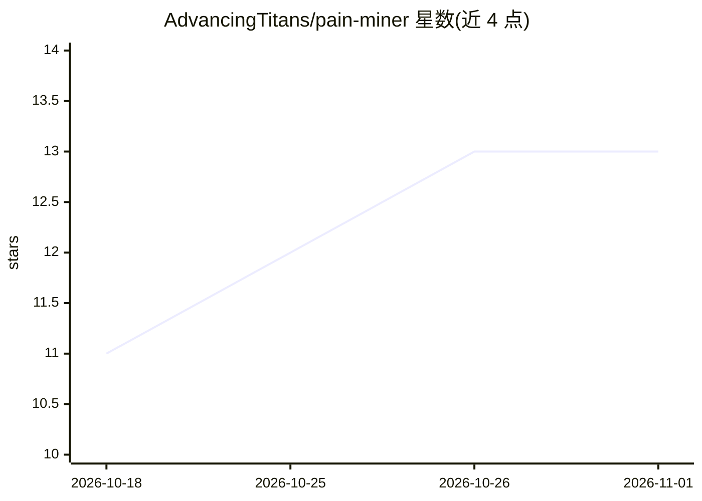

# AdvancingTitans/pain-miner

⭐ 13 · Python · MIT · 推送 2026-07-11 · [GitHub](https://github.com/AdvancingTitans/pain-miner) · 组织维护 · 中文 README

**从社区热帖挖用户痛点、产出微型产品创意证据的 CLI**

面向独立开发者与微型 SaaS 构建者的 Python 命令行研究工具：给定一句目标用户描述，自动发现 Reddit / Hacker News / V2EX 候选社区，抓取高赞高评帖子与评论，标注帖子意图、商业信号与风险标记，输出可审计 JSON，并可渲染为含来源帖与反证的九节 Markdown 报告。全程默认免登录，数据源包括 Arctic Shift、Algolia/Firebase、V2EX 公开 API 与 Jina Reader 兜底。既可作为普通 CLI 运行，也可装入 AI Agent 技能目录（SKILL.md）配合 Agent 使用。证据不足时不生成结论，机会卡为空并列出下一步取证动作。

## 筛选速览

| 维度 | 判定 | 备注 |
|---|---|---|
| AI 角色 | `ai-enhanced` | 去掉 AI 部分产品仍成立 |
| 许可风险 | `permissive` | MIT |
| 部署形态 | `None` |  |
| 模型依赖 | — | README 未给出锁定关系 |
| 硬件要求 | — | 无带数字的原话,不猜 |
| 安装摩擦 | `low` | 无编译、无系统依赖或容器化 |
| 成熟度 | — | 结构信号不足 |

## 能力要点

- Reddit / Hacker News / V2EX 免登录采集，含浏览器兜底（Jina Reader）
- 输出可审计 JSON，帖子附 post_intent / commercial_signals / evidence_type / risk_flags
- render-report 生成九节 Markdown 报告，含来源帖、反证与验证方案
- 跨社区对照（compare-communities）区分共识与分歧，根因保持 unknown 直至人工核验

## 适用场景

- 做独立产品前先收集社区真实抱怨作为证据
- 对比同一主题在不同社区的痛点共识与分歧
- 为 AI Agent 配备社区痛点调研技能

## 场景标签

`网页抓取` · 领域:效率与自动化

## 证据(README 行号)

> L21: - Works as a plain Python CLI or as an AI-agent skill.
> L55: Agent 会读取 `SKILL.md`，自动跑脚本拿证据，再生成完整 Markdown 报告。

## 星数曲线

2026-10-18 11 → 2026-11-01 13（+2）

---
*卡片 v1 · prompt 1.4 · 生成 2026-10-31 · 置信度 high · 依据 README sha `062b56463fd0` · [字段定义](../../DATASET.md)*
