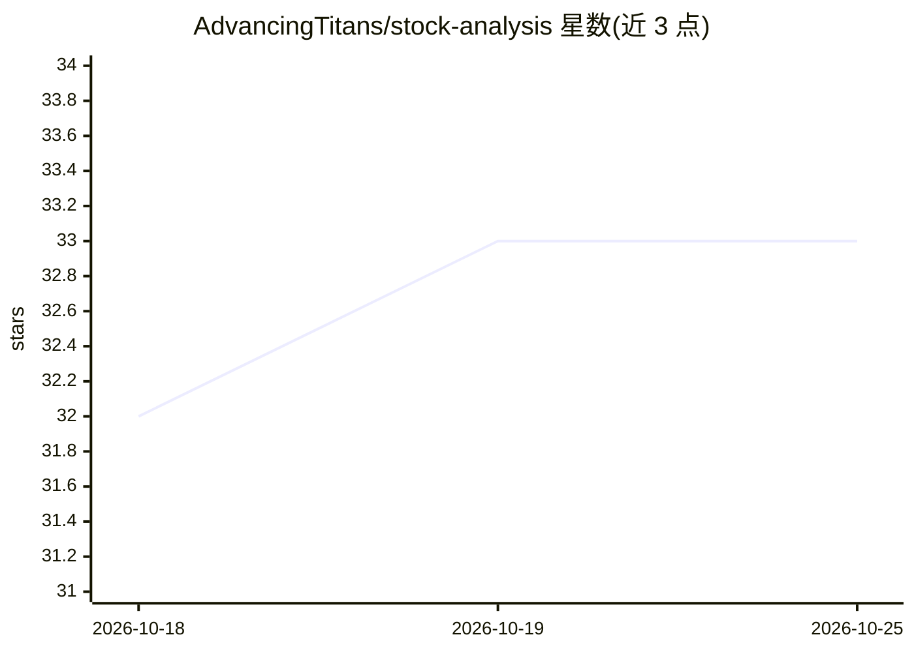

# AdvancingTitans/stock-analysis

⭐ 33 · Python · MIT · 推送 2026-07-28 · [GitHub](https://github.com/AdvancingTitans/stock-analysis) · [官网](https://github.com/AdvancingTitans/stock-analysis) · 组织维护 · 中文 README

**面向投资者的证据驱动股票研究 CLI：一问进，一报告出**

开源投资研究系统，非选股器、非自动交易：以自然语言提问，系统识别研究场景（公司/基金ETF/市场/财报/异动/筛选/组合），采集公开证据并校验来源与时间边界，应用金融框架生成含结论、估值、风险与行动条件的研究报告。支持 A/HK/US/JP/KR 股票与公募基金、ETF，提供 Quick/Standard/Deep 三档深度及 15 位投资专家框架（Buffett、Graham、段永平等）与对抗式研究。事实/衍生事实/分析三级发布规则限定模型不得编造缺失事实。以 uv 安装的 CLI 与 Agent 安装器两种方式提供，MIT 许可，Python 3.9+。

## 筛选速览

| 维度 | 判定 | 备注 |
|---|---|---|
| AI 角色 | `ai-native` | 本体是模型或模型工具 |
| 许可风险 | `permissive` | MIT |
| 部署形态 | `None` |  |
| 模型依赖 | — | README 未给出锁定关系 |
| 硬件要求 | — | 无带数字的原话,不猜 |
| 安装摩擦 | `low` | 无编译、无系统依赖或容器化 |
| 成熟度 | — | 结构信号不足 |

## 能力要点

- 21 个确定性章节契约覆盖 7 类研究场景（公司/基金/市场/财报/异动/组合/筛选）
- 15 个专家框架研究协议，支持单专家、并行、对抗与委员会模式
- 证据优先流程：来源质量与时效校验、静默回退、查询预算，事实三级发布规则
- 覆盖 A/HK/US/JP/KR 股票与基金/ETF，不自动下单、不承诺收益

## 适用场景

- 输入一个问题获得完整公司或 ETF 研究报告
- 用 Buffett 与 Soros 等对抗框架对同一标的做双向分析
- 复盘今日 A 股市场、个股异动或财报对投资逻辑的影响
- 通过 Agent 宿主（Claude Code/Codex）以对话方式调用研究命令

## 场景标签

`金融量化` `科研工具` · 领域:学习与行业

## 证据(README 行号)

> L25: `stock-analysis` is an open-source investment research system, not an AI stock picker and not an auto-trading tool.

## 星数曲线

2026-10-18 32 → 2026-10-25 33（+1）

---
*卡片 v1 · prompt 1.4 · 生成 2026-10-25 · 置信度 high · 依据 README sha `7c9ee86951ce` · [字段定义](../../DATASET.md)*
