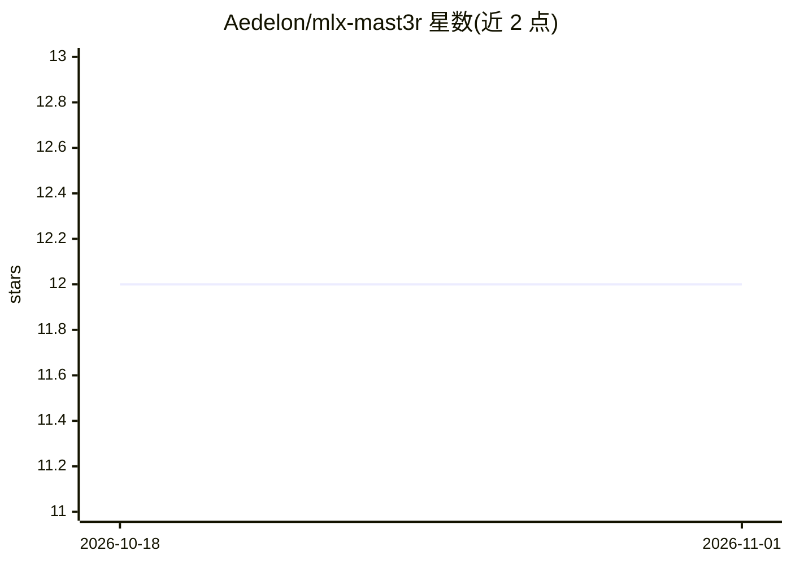

# Aedelon/mlx-mast3r

⭐ 12 · Python · 推送 2026-01-22 · [GitHub](https://github.com/Aedelon/mlx-mast3r) · 个人维护

**在 Apple Silicon 上以 MLX 运行 MASt3R/DuneMASt3R 的 3D 重建库**

将 MASt3R、DUNE 与 DuneMASt3R 系列模型移植到 Apple MLX 框架，供 M1-M4 芯片的 Mac 做单目/多视图 3D 重建、深度估计与立体匹配。提供 DUNE/MASt3R/DuneMast3r/Mast3rFull 四类模型 API、多视图稀疏全局对齐、五种场景图配对策略、TSDF 深度后处理与 Gradio 网页演示；权重从 HuggingFace Hub 自动下载，缓存于 ~/.cache/mlx-mast3r/。要求 macOS 13+、Apple Silicon、Python 3.10+、MLX 0.22+。

## 筛选速览

| 维度 | 判定 | 备注 |
|---|---|---|
| AI 角色 | `ai-native` | 本体是模型或模型工具 |
| 许可风险 | `none` | — |
| 部署形态 | `library` | 以包/库形式分发 |
| 模型依赖 | — | README 未给出锁定关系 |
| 硬件要求 | — | 无带数字的原话,不猜 |
| 安装摩擦 | `low` | 无编译、无系统依赖或容器化 |
| 成熟度 | — | 结构信号不足 |

## 能力要点

- MLX 实现 MASt3R/DUNE/DuneMASt3R，含自定义 Metal 内核（Fused RoPE 2D 等）
- 支持 FP16/BF16 精度以降低内存占用
- 多视图重建：稀疏全局对齐、5 种场景图类型、TSDF 深度清理
- 权重从 HuggingFace Hub 自动下载，附 Gradio 交互演示

## 适用场景

- 在 Mac 上对多张照片做场景 3D 重建与相机位姿优化
- 快速提取图像特征图或深度图用于视觉任务
- 通过 Gradio 界面交互式体验立体重建

## 场景标签

`图像视频处理` · 领域:感知与多模态

## 证据(README 行号)

> L3: Ultra-optimized MLX implementation of MASt3R and DuneMASt3R for 3D reconstruction on Apple Silicon.
> L204: Reconstruction outputs (`reconstruct()`):
> L274: Weights are **automatically downloaded** from HuggingFace Hub when calling `from_pretrained()`.

## 星数曲线

2026-10-18 12 → 2026-11-01 12（+0）

---
*卡片 v1 · prompt 1.4 · 生成 2026-11-01 · 置信度 high · 依据 README sha `a889458b9fd8` · [字段定义](../../DATASET.md)*
