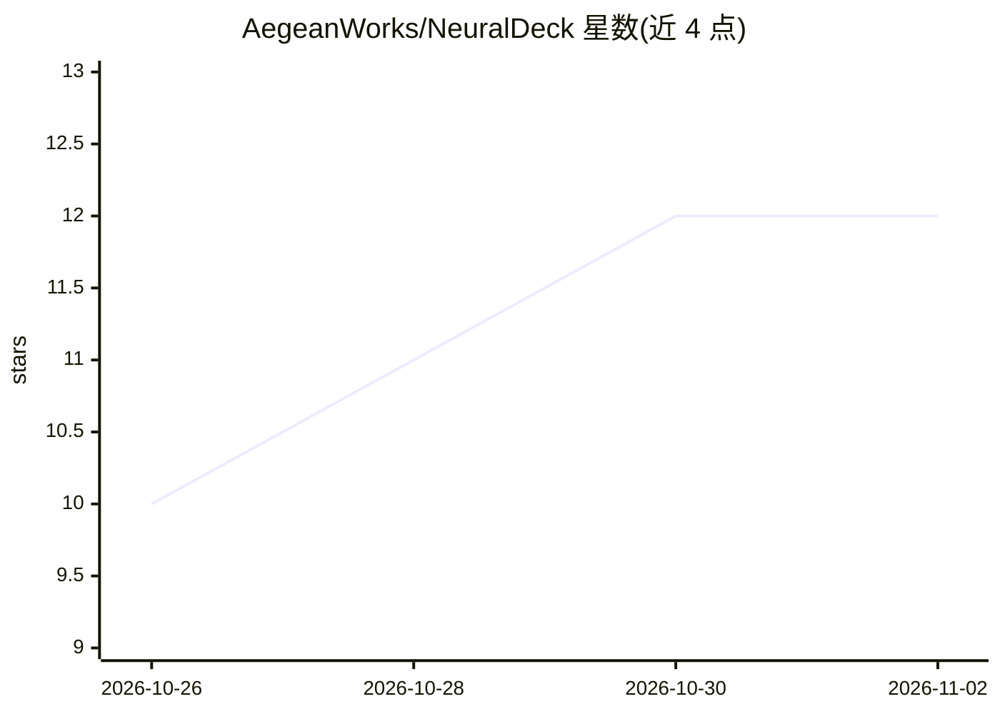

# AegeanWorks/NeuralDeck

⭐ 12 · Python · NOASSERTION · 推送 2026-11-01 · [GitHub](https://github.com/AegeanWorks/NeuralDeck) · [官网](https://twitter.com/Aegean_E) · 组织维护

**离线桌面应用：用本地 LLM 把文档自动生成 Anki 记忆卡**

面向学生与研究者的桌面应用：读取 PDF/Word/PowerPoint/文本，通过 OpenAI 兼容的本地 LLM 服务器（默认 LM Studio）生成问答式 Anki 记忆卡，支持卡片密度控制、可选的二次 AI 润色、Yes/No 题过滤与按内容自动匹配既有牌组。生成后可在界面中逐张编辑、勾选，再经 NeuralDeck Bridge Anki 插件一键同步到本地 Anki。全程本地处理，文档不上传云端。运行需 Python 3.10+、桌面版 Anki 与本地 LLM 服务器；个人使用免费（AL-1.1），商用需 ACL-1.0 许可。

## 筛选速览

| 维度 | 判定 | 备注 |
|---|---|---|
| AI 角色 | `ai-native` | 本体是模型或模型工具 |
| 许可风险 | `none` | NOASSERTION |
| 部署形态 | `desktop` | 安装包/桌面程序 |
| 模型依赖 | — | README 未给出锁定关系 |
| 硬件要求 | — | 无带数字的原话,不猜 |
| 安装摩擦 | `low` | 无编译、无系统依赖或容器化 |
| 成熟度 | — | 结构信号不足 |

## 能力要点

- 本地 LLM 生成 Anki 卡片，数据不出本机
- 支持 PDF/docx/pptx/txt 多格式文本抽取
- Smart Deck Matching 按内容自动归类到既有牌组
- 通过 Anki Bridge 插件直接同步，含可移植 exe 版本

## 适用场景

- 把教材、讲义、论文批量转成 Anki 记忆卡
- 医学、法律等科目做高密度细节卡片
- 生成后逐张审核编辑再同步，控制卡片质量

## 场景标签

`AI 写作` `文档解析` · 领域:内容生成

## 证据(README 行号)

> L44: **NeuralDeck** is a powerful desktop application that transforms your study materials—PDFs, Word documents, and Pow
> L52: - **🤖 LLM-Powered**: Utilizes state-of-the-art local LLMs (like Llama 3, Mistral, or Phi-3 via LM Studio) to unders

## 星数曲线

2026-10-26 10 → 2026-11-02 12（+2）

---
*卡片 v1 · prompt 1.4 · 生成 2026-11-01 · 置信度 mid · 依据 README sha `a6e469b81535` · [字段定义](../../DATASET.md)*
