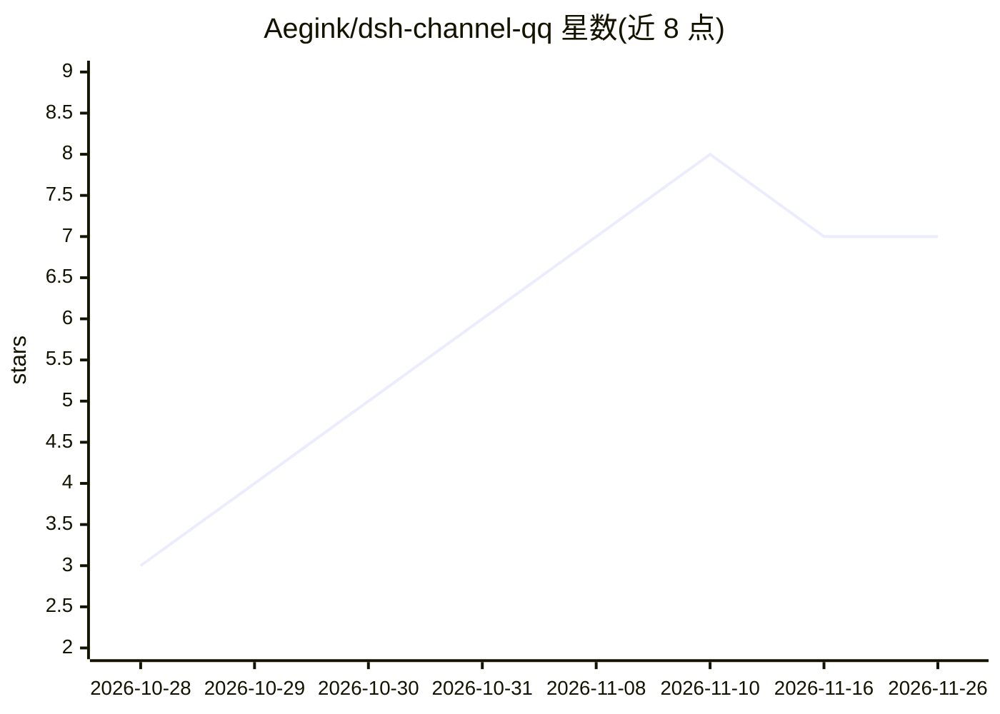

# Aegink/dsh-channel-qq

⭐ 7 · TypeScript · MIT · 推送 2026-10-31 · [GitHub](https://github.com/Aegink/dsh-channel-qq) · [官网](https://github.com/Aegink/dsh-channel-qq) · 组织维护 · 中文 README

**把 QQ 接入 DeepSeek Harness 的渠道插件**

以 cordis Service 形式挂载到 dsh 宿主的 QQ 渠道插件，经 OneBot v11（默认 SnowLuma，NapCat 作回滚）收发消息。提供 90 个细粒度工具（tools.v2 合并为 18 个动作组）、日记→结构化→检索的长期记忆（夜间九个任务）、SKILL.md 技能包、事件书驱动的主动行为、审批网关与 27 页管理后台。需 Node.js 22+ 与 dsh 宿主及 OneBot v11 协议端；源自 DandanLLab/dsh-channel-qq 早期版本继续演进，声明非官方、协议端账号风控为常态。

## 筛选速览

| 维度 | 判定 | 备注 |
|---|---|---|
| AI 角色 | `ai-ecosystem` | LLM/agent 周边工具 |
| 许可风险 | `permissive` | MIT |
| 部署形态 | `library` | 以包/库形式分发 |
| 模型依赖 | locked-api |  |
| 硬件要求 | — | 无带数字的原话,不猜 |
| 安装摩擦 | `low` | 无编译、无系统依赖或容器化 |
| 成熟度 | `idea` | |

## 能力要点

- 90 个工具（tools.v2 合并为 18 个动作组）与群聊准入过滤
- 长期记忆：夜间分块/抽取/反思/遗忘/向量重建，每回合注入 3–8 条证据
- 高危命令 L0–L3 分级审批网关与一次性令牌
- 27 个页面的管理后台：配置热生效、审计、模型供应商管理

## 适用场景

- 让个人 QQ 号作为长期陪伴/群运营机器人住在群里
- 给 dsh 宿主的 agent 接入 QQ 群聊/私聊消息通道
- 通过管理后台与私聊命令管理机器人会话与访问审批

## 场景标签

`聊天机器人` · 领域:对话与助手

## 证据(README 行号)

> L7: 把 QQ 接入 DeepSeek Harness 的渠道插件。
> L10: 以 cordis `Service` 形式挂进 dsh，提供工具面、长期记忆、主动行为与管理后台。
> L59: |官方 dsh-qqbot|QQ Bot API v2|官方机器人身份、扫码、流式回复；不接个人号|

## 星数曲线

2026-10-28 3 → 2026-11-26 7（+4）

---
*卡片 v1 · prompt 1.4 · 生成 2026-11-20 · 置信度 high · 依据 README sha `83838aebac97` · [字段定义](../../DATASET.md)*
