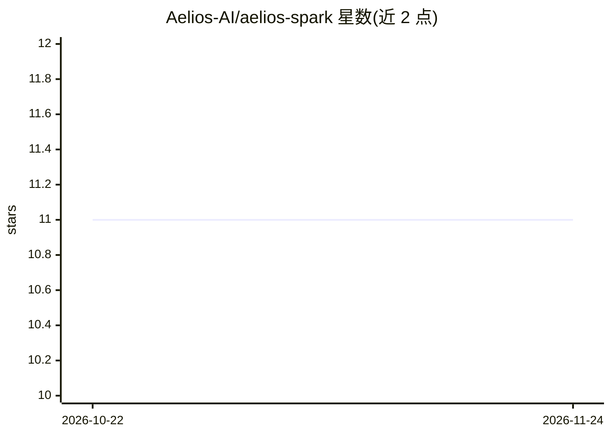

# Aelios-AI/aelios-spark

⭐ 11 · Python · Apache-2.0 · 推送 2026-07-16 · [GitHub](https://github.com/Aelios-AI/aelios-spark) · [官网](https://www.aeliosai.com/) · 组织维护

**给 Web 应用加 37 种语言语音控制的开源组件与 Agent 服务端**

由浏览器端嵌入式 Widget 与自托管的 Python Agent 服务端组成：Widget 采集音频并持有工具注册表，服务端运行 Pipecat 语音管线（STT→LLM→TTS），通过 WebRTC + RTVI 协议通信，由 LLM 生成工具调用来操作宿主页面。支持 action（代为操作）与 guide（只读讲解+幽灵光标）两种模式，STT 用 Deepgram Nova-3 覆盖 37 种语言，TTS 用 Cartesia。需自备 OpenAI、Daily、Deepgram、Cartesia、Google AI Studio 的 API key；仅支持桌面端视口。

## 筛选速览

| 维度 | 判定 | 备注 |
|---|---|---|
| AI 角色 | `ai-native` | 本体是模型或模型工具 |
| 许可风险 | `permissive` | Apache-2.0 |
| 部署形态 | `None` |  |
| 模型依赖 | local-ok | 支持本地模型 |
| 硬件要求 | — | 无带数字的原话,不猜 |
| 安装摩擦 | `low` | 无编译、无系统依赖或容器化 |
| 成熟度 | — | 结构信号不足 |

## 能力要点

- 37 种语言语音交互，STT/TTS 按会话配置
- action/guide 双模式：工具调用与只读讲解由不同 schema 门控
- AeliosSpark.defineTool 在页面代码中注册可调用工具
- 语音服务与传输层为 Pipecat 适配器，可在 bot.py 中替换

## 适用场景

- 让访客用语音在我的 Web 应用里创建记录、导航、执行查询
- 为产品做无障碍语音引导与屏幕讲解
- 自托管语音 Agent，不依赖 SaaS 注册

## 场景标签

`语音 Agent` · 领域:对话与助手

## 证据(README 行号)

> L7: Aelios Spark is an open-source voice control layer for web apps. Drop in a
> L73:  pipeline — STT → LLM → TTS → audio out — plus the
> L221: |OpenAI|Main LLM|yes|

## 星数曲线

2026-10-22 11 → 2026-11-24 11（+0）

---
*卡片 v1 · prompt 1.4 · 生成 2026-11-19 · 置信度 mid · 依据 README sha `44c136d9cb6e` · [字段定义](../../DATASET.md)*
