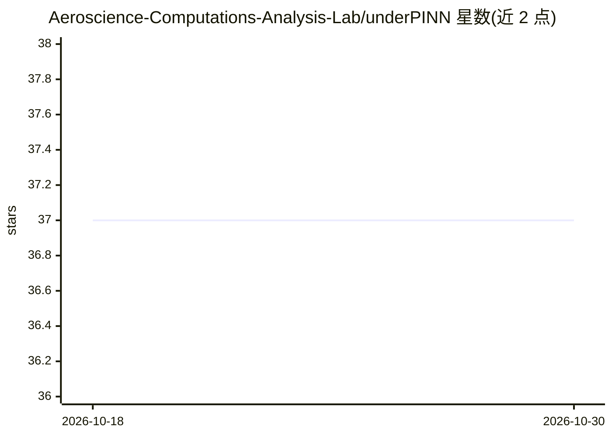

# Aeroscience-Computations-Analysis-Lab/underPINN

⭐ 37 · Python · GPL-3.0 · 推送 2026-10-10 · [GitHub](https://github.com/Aeroscience-Computations-Analysis-Lab/underPINN) · [官网](http://docs.underpinn.dev/) · 组织维护

**给科研与工程用户：基于 JAX 的物理信息神经网络（PINN）求解 PDE 的模块化框架**

基于 JAX + Flax + Optax 的物理信息神经网络研究框架，用于 PDE 约束的学习与求解。提供 MLP/GatedMLP/FourierMLP/FBPINN 等网络架构，以及 FNO/DeepONet/CViT 神经算子；训练机制含 lax.scan 融合内核、RBA 自适应加权、多种残差自适应采样、可学习人工黏性激波捕捉、时间推进迁移学习、Gauss-Newton 二阶优化与完整的重启/恢复系统。内置 PDE 库覆盖 Burgers、扩散、Helmholtz、不可压/可压 Navier-Stokes、Carreau 血液流变等案例，几何模块含 NACA 翼型、圆柱、AAA 瘤体等。通过 XLA 在 CPU/GPU/TPU 上 JIT 编译运行，经 PyPI 安装。

## 筛选速览

| 维度 | 判定 | 备注 |
|---|---|---|
| AI 角色 | `ai-native` | 本体是模型或模型工具 |
| 许可风险 | `viral` | GPL-3.0 |
| 部署形态 | `library` | 以包/库形式分发 |
| 模型依赖 | — | README 未给出锁定关系 |
| 硬件要求 | — | 无带数字的原话,不猜 |
| 安装摩擦 | `medium` | 含编译或系统依赖之一 |
| 成熟度 | — | 结构信号不足 |

## 能力要点

- MLP/GatedMLP/FourierMLP/FBPINN 与 HybridAttention 架构，FBPINN 支持重叠子域分解
- FNO1D/FNO2D/DeepONet/CViT 神经算子，一次训练泛化到 IC/PDE 参数分布
- RBA 加权、RAR-D/RAD/QR-DEIM 自适应配点重采样、可学习人工黏性激波捕捉
- RestartManager 完整断点续训：参数、优化器状态、损失历史与 MD5 配置校验

## 适用场景

- 求解流体力学 PDE（圆柱绕流、NACA 翼型、可压缩激波问题）
- 做反问题，如从数据恢复热扩散率
- 长时程非定常问题用时间推进迁移学习逐窗口训练
- 用神经算子训练跨初始条件/参数泛化的代理模型

## 场景标签

`科研工具` · 领域:学习与行业

## 证据(README 行号)

> L2: > A modular, GPU-accelerated Physics-Informed Neural Network framework built on JAX + Flax + Optax
> L6: underPINN is a research-grade PINN engine that combines classical collocation-based PINNs with Finite Basis decompos

## 星数曲线

2026-10-18 37 → 2026-10-30 37（+0）

---
*卡片 v1 · prompt 1.4 · 生成 2026-10-25 · 置信度 high · 依据 README sha `eb27be51ff24` · [字段定义](../../DATASET.md)*
