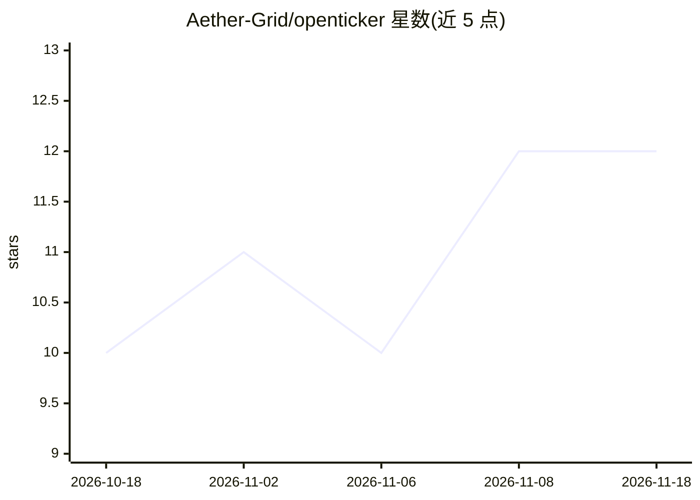

# Aether-Grid/openticker

⭐ 12 · Rust · MPL-2.0 · 推送 2026-07-14 · [GitHub](https://github.com/Aether-Grid/openticker) · [官网](https://openticker.com/) · 组织维护

**面向股票与加密现货交易的可配置 Rust 交易运行时**

由多个 Rust crate 组成的工作区，提供长期运行的交易编排运行时：连接器化的行情数据与执行抽象、基于 Axum 的 HTTP 控制平面、CLI 与 Ratatui 仪表盘（九个工作区视图）、SQLite 日志与启动对账恢复。策略通过 TOML 配置组装，绑定行情、账户、连接器、指标与风控档案；开源版内置 sma_crossover 与 rsi_threshold 两个指标，扩展指标包需启用 Cargo feature 编译。仅用于开发、研究、测试与教育用途。

## 筛选速览

| 维度 | 判定 | 备注 |
|---|---|---|
| AI 角色 | `ai-enhanced` | 去掉 AI 部分产品仍成立 |
| 许可风险 | `permissive` | MPL-2.0 |
| 部署形态 | `None` |  |
| 模型依赖 | — | README 未给出锁定关系 |
| 硬件要求 | — | 无带数字的原话,不猜 |
| 安装摩擦 | `medium` | 含编译或系统依赖之一 |
| 成熟度 | — | 结构信号不足 |

## 能力要点

- 单运行时编排行情、信号、风控、执行、账本与对账循环
- Axum 控制平面与 Ratatui 仪表盘提供九个运行时状态视图
- TOML 配置驱动 bot 组装，内置指标经 Cargo feature 门控扩展
- SQLite 日志与启动对账恢复机制

## 适用场景

- 搭建股票与加密现货的本地自动化交易运行时
- 通过仪表盘监控 bot 的持仓、盈亏与行情流状态
- 以自有指标包扩展内置信号并验证策略配置

## 场景标签

`金融量化` · 领域:学习与行业

## 证据(README 行号)

> L3: OpenTicker is a multi-crate Rust workspace for configurable spot-trading runtime orchestration across equities and c
> L210: OpenTicker is an open-source software project published by Aether Holdings in connection with its work in stocks, 

## 星数曲线

2026-10-18 10 → 2026-11-18 12（+2）

---
*卡片 v1 · prompt 1.4 · 生成 2026-11-18 · 置信度 low · 依据 README sha `e1efd555a8d2` · [字段定义](../../DATASET.md)*
