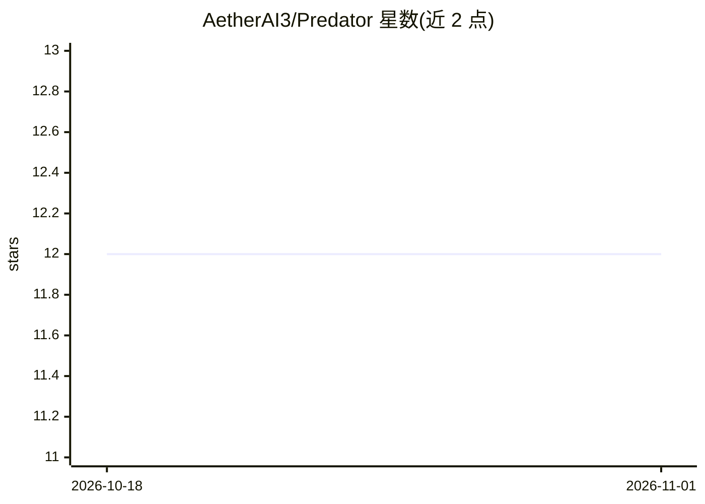

# AetherAI3/Predator

⭐ 12 · 推送 2026-10-31 · [GitHub](https://github.com/AetherAI3/Predator) · [官网](https://aetherai3.github.io/Predator/) · 个人维护

**AI 安全研究与软件修复 agent 的公开展示与证据仓库**

Predator 是 Aether AI 的 AI 安全研究项目，README 为公开的功能展示与证据汇集：核心的 Crucible 研究循环从固定源码版本出发，用 QUBO/能量模型对候选链排序，并要求对真实软件的核验通过后才纳入结果。展示内容包括 P-BOX 一次性 Linux 虚拟机中的 HTB 训练记录（Nmap 课程 12/12、Satellite 9/9 实验室），以及对 Vercel AI SDK、Gemini CLI、GitLab Duo、Anthropic SDK 等目标的 Gen3 安全研究记录。CLI 与运营引擎为私有，仓库本身不提供可安装的软件；README 明确声明未证明量子优势。

## 筛选速览

| 维度 | 判定 | 备注 |
|---|---|---|
| AI 角色 | `ai-native` | 本体是模型或模型工具 |
| 许可风险 | `none` | — |
| 部署形态 | `None` |  |
| 模型依赖 | — | README 未给出锁定关系 |
| 硬件要求 | — | 无带数字的原话,不猜 |
| 安装摩擦 | `medium` | 含编译或系统依赖之一 |
| 成熟度 | `idea` | |

## 能力要点

- Crucible 研究循环：候选链排序 + 真实软件核验后才入库
- P-BOX 一次性 Linux VM 中的可观测、可接管自主任务执行
- HTB 训练证据：课程/实验室完成记录与回放
- Gen3 阶段五项安全研究记录（含 MITRE ATT&CK 战术映射）

## 适用场景

- 查看 AI agent 在授权 CTF/HTB 环境中的自主执行证据
- 了解 Crucible 证据式安全研究方法与量子实验定位
- 跟进 Gen3 对多个 AI SDK/CLI 的安全研究状态

## 场景标签

`网络安全` · 领域:学习与行业

## 证据(README 行号)

> L12: **AI security research, software repair, and authorized VM workflows.**
> L14: Predator brings AI reasoning, persistent context, and reviewed tool use into security research and software repair.
> L16: This is the **public feature showcase and evidence collection**. The CLI and operator engines are private, with rev

## 星数曲线

2026-10-18 12 → 2026-11-01 12（+0）

---
*卡片 v1 · prompt 1.4 · 生成 2026-11-01 · 置信度 mid · 依据 README sha `cfe4ee14254c` · [字段定义](../../DATASET.md)*
