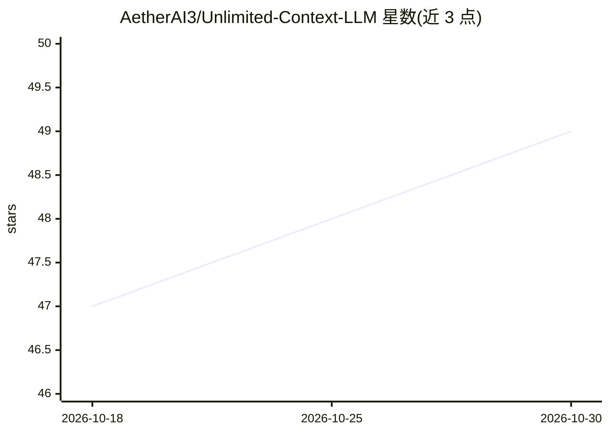

# AetherAI3/Unlimited-Context-LLM

⭐ 49 · Python · Apache-2.0 · 推送 2026-10-28 · [GitHub](https://github.com/AetherAI3/Unlimited-Context-LLM) · [官网](https://aetherai3.github.io/Unlimited-Context-LLM/) · 组织维护

**给本地 LLM 提供十亿级 token 磁盘记忆池的上下文引擎**

为 Ollama 等本地或 API 模型提供虚拟内存式的上下文引擎：把溢出窗口的内容编码到本机磁盘池（约 5GB≈约 11.6 亿 token），按需以切片形式取回，模型保持小窗口不变。检索用余弦相似度加 MPO 上下文链，取回内容限制在模型窗口的 20% 以内。提供 CLI（setup/run/chat/doctor/status）与 Python Session API，支持 pip、npx、pipx 安装。限制：达到的 token 数依赖检索命中率，非更大注意力窗口；基准主数据来自托管推理模型而非本地模型。

## 筛选速览

| 维度 | 判定 | 备注 |
|---|---|---|
| AI 角色 | `ai-ecosystem` | LLM/agent 周边工具 |
| 许可风险 | `permissive` | Apache-2.0 |
| 部署形态 | `library` | 以包/库形式分发 |
| 模型依赖 | local-ok | 支持本地模型 |
| 硬件要求 | — | 无带数字的原话,不猜 |
| 安装摩擦 | `low` | 无编译、无系统依赖或容器化 |
| 成熟度 | — | 结构信号不足 |

## 能力要点

- 磁盘上下文池按切片取回，5GB 约对应 11.6 亿 token 编码容量
- MPO 上下文链在余弦检索上补取关联切片，可禁用并回退纯余弦
- 取回内容上限为模型窗口的 20%，池可随时非破坏性重设大小
- 无守护进程、无网络也可运行（内置 mock 模型）

## 适用场景

- 长时 agent 任务中保留早期事实、避免窗口溢出后遗忘
- 本地模型在多个 run 之间共享同一记忆池目录
- 在 8GB 内存机器上运行多个隔离会话（separate/shared 池模式）

## 场景标签

`Agent 记忆` · 领域:Agent 开发

## 证据(README 行号)

> L3: **Virtual memory for an LLM's attention.** Keep a billion-token pool on your own disk; the model
> L121: - 🤖 **Any model** — Llama, Qwen, Mistral, Phi — via Ollama, llama.cpp, or Hugging Face, or your own API-backed mod
> L227: |`aether-context doctor`|Check Ollama, your model, disk, and RAM before a long run.|

## 星数曲线

2026-10-18 47 → 2026-10-30 49（+2）

---
*卡片 v1 · prompt 1.4 · 生成 2026-10-25 · 置信度 high · 依据 README sha `a2473b6fbf9c` · [字段定义](../../DATASET.md)*
