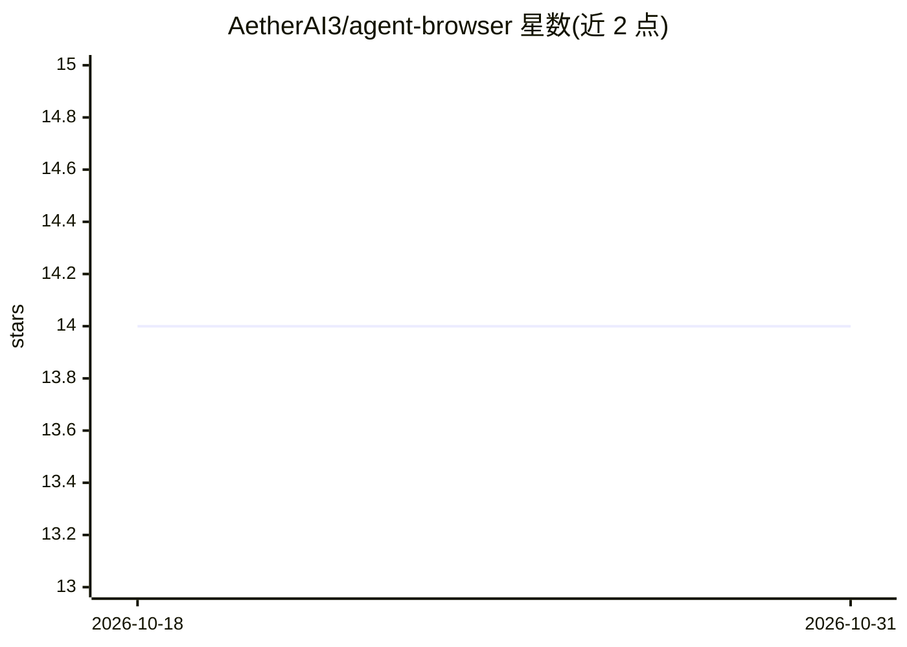

# AetherAI3/agent-browser

⭐ 14 · Python · Apache-2.0 · 推送 2026-10-27 · [GitHub](https://github.com/AetherAI3/agent-browser) · [官网](https://aetherai3.github.io/agent-browser/) · 组织维护

**给 AI agent 的自托管 Chrome：单会话 API 控制+人可实时接管**

自托管运行时：通过 Docker Compose 启动 Xvfb/x11vnc/noVNC/FastAPI 栈，维护单个有头 Chrome 会话；agent 经 JSON API（session/create、navigate、snapshot 等）驱动浏览器，人通过 noVNC 实时查看同一会话并可随时接管，适合 2FA、登录、支付等 human-in-the-loop 场景。提供 npm 与 PyPI 同名客户端（aether-browser）、MCP server（9 个 stdio 工具，支持 Claude Code/Cursor 等），可选 Jev 层经 OpenRouter 做导航决策。限制：v0.x noVNC 无鉴权仅限本地回环，快速启动仅支持 Linux Docker Engine+Compose v2；不含 LLM 调用、无托管服务、无任意 JS/CDP 接口。

## 筛选速览

| 维度 | 判定 | 备注 |
|---|---|---|
| AI 角色 | `ai-ecosystem` | LLM/agent 周边工具 |
| 许可风险 | `permissive` | Apache-2.0 |
| 部署形态 | `self-host` | docker 或自建部署 |
| 模型依赖 | — | README 未给出锁定关系 |
| 硬件要求 | — | 无带数字的原话,不猜 |
| 安装摩擦 | `low` | 无编译、无系统依赖或容器化 |
| 成熟度 | `idea` | |

## 能力要点

- 单会话双参与者：agent 经 JSON API 操作，人经 noVNC 实时查看并接管
- MCP server 提供 9 个工具，npm/PyPI 客户端同版本发布
- 安全边界：回环监听、HTTP(S) 目标校验、TCP 代理固定浏览器出口、有界输入输出
- 结构化状态优先：可读文本+有界可访问性树先于截图返回

## 适用场景

- 让 agent 操作真实浏览器登录时，由人补输 2FA/验证码后继续
- 浏览器自动化任务中人工实时监督与中途接管
- 为 MCP 客户端（Claude Code/Cursor 等）提供可控的浏览器工具

## 场景标签

`浏览器自动化` · 领域:效率与自动化

## 证据(README 行号)

> L38: Agent Browser runs **one headed Chrome session**. Your agent drives it through a small JSON API,
> L213: - **Model-agnostic and self-hosted.** Bring the framework you already use, and keep the browser on
> L226: |MCP|Nine stdio tools from either client (`aether-browser mcp`), no extra dependencies|

## 星数曲线

2026-10-18 14 → 2026-10-31 14（+0）

---
*卡片 v1 · prompt 1.4 · 生成 2026-10-31 · 置信度 high · 依据 README sha `84ad30f8e3d4` · [字段定义](../../DATASET.md)*
