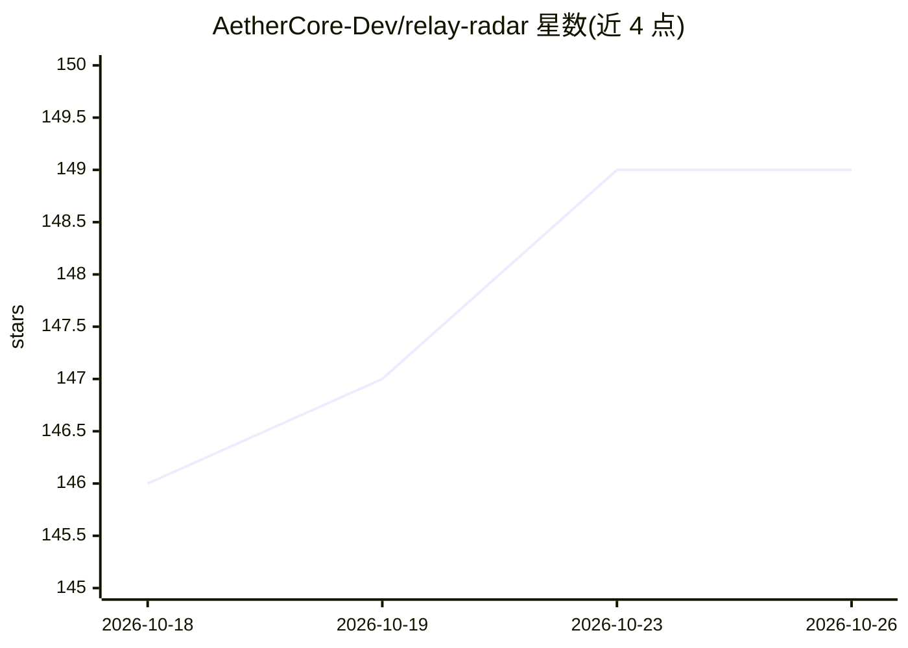

# AetherCore-Dev/relay-radar

⭐ 149 · JavaScript · 推送 2026-10-19 · [GitHub](https://github.com/AetherCore-Dev/relay-radar) · [官网](https://aethercore-dev.github.io/relay-radar/) · 组织维护 · 中文 README

**AI 中转站质量检测工具：验模型真假、审计 Token 计费**

面向使用第三方中转站访问 Claude/GPT API 的开发者的命令行工具（npx 运行，零依赖，MIT）。提供两类模型验真：monitor 在正常编码时后台分析回复行为指纹判断模型是否被偷换（盲测准确率 98%）；verify 发 8 个标准化探针问题（复现 USENIX Security 2025 LLMmap）。另有计费审计（检测隐藏 Prompt 注入与 Token 虚增）、本地使用统计、省 Token 配置生成、延迟测试与中转站五维排名网站。API Key 仅从环境变量读取，不落盘。

## 筛选速览

| 维度 | 判定 | 备注 |
|---|---|---|
| AI 角色 | `ai-ecosystem` | LLM/agent 周边工具 |
| 许可风险 | `none` | — |
| 部署形态 | `library` | 以包/库形式分发 |
| 模型依赖 | — | README 未给出锁定关系 |
| 硬件要求 | — | 无带数字的原话,不猜 |
| 安装摩擦 | `low` | 无编译、无系统依赖或容器化 |
| 成熟度 | — | 结构信号不足 |

## 能力要点

- monitor 后台行为指纹检测模型偷换（宣称盲测准确率 98%）
- verify 复现 USENIX Security 2025 LLMmap 方法，8 个探针问题
- 逐笔计费审计：隐藏 Prompt 注入与 Token 虚增检测
- 五维评分的中转站公开排名网站，自费实测

## 适用场景

- 怀疑中转站用便宜模型替换我买的 Opus，验一下真假
- 审计中转站是否偷注 System Prompt 多收 Token 费
- 给项目生成省 Token 配置并查看本地 Claude Code 花费
- 对比选择靠谱的 API 中转站

## 场景标签

`模型评测` · 领域:评测与运维

## 证据(README 行号)

> L17: - 部分中转站**偷偷用便宜模型替换**你买的贵模型
> L23: **1. 模型是真的吗？** — 你付了Opus的钱，中转站偷偷给你Sonnet。RelayRadar 一查便知——盲测准确率 98%（100组 Opus vs Sonnet 替换测试）。
> L66: |**原理**|在你正常写代码时，自动分析AI回复的用词习惯、代码风格，判断是不是真模型|发8个精心设计的问题，不同模型的回答方式会暴露真实身份|

## 星数曲线

2026-10-18 146 → 2026-10-26 149（+3）

---
*卡片 v1 · prompt 1.4 · 生成 2026-10-23 · 置信度 high · 依据 README sha `7d2c21d391c3` · [字段定义](../../DATASET.md)*
