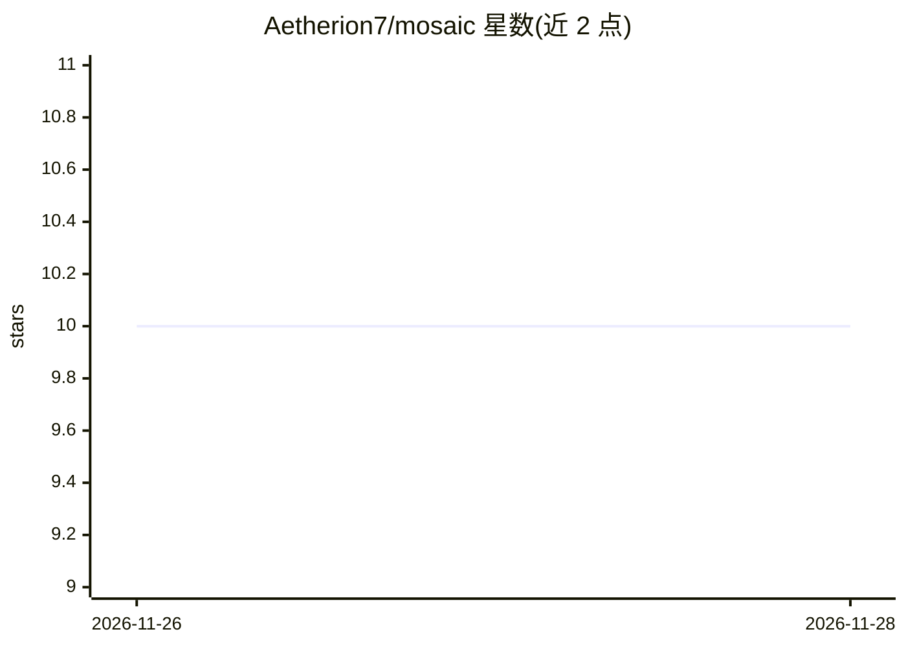

# Aetherion7/mosaic

⭐ 10 · TypeScript · NOASSERTION · 推送 2026-11-19 · [GitHub](https://github.com/Aetherion7/mosaic) · [官网](https://aetherion7.github.io/mosaic/) · 个人维护

**本地优先的桌面小组件仪表盘，可选 AI 助手帮你搭面板**

本地运行于浏览器 IndexedDB 的个人仪表盘：将任务、日历、笔记、表格、绘图板、PDF/EPUB 阅读器等 17 类小组件排布在无限画布的 board 上，数据全部留在本地设备，无账号无服务器。提供 20 个内置主题、自定义字体、JSON 导入导出备份。可选启用 AI 助手（自带 Anthropic/OpenAI/Gemini 或 OpenAI 兼容密钥，包括本地 Ollama/LM Studio），可代为增删和样式化小组件，密钥直连所选服务商。提供 Windows/macOS/Linux 安装包，未做代码签名首次启动会有警告。

## 筛选速览

| 维度 | 判定 | 备注 |
|---|---|---|
| AI 角色 | `ai-enhanced` | 去掉 AI 部分产品仍成立 |
| 许可风险 | `none` | NOASSERTION |
| 部署形态 | `desktop` | 安装包/桌面程序 |
| 模型依赖 | local-ok | 支持本地模型 |
| 硬件要求 | — | 无带数字的原话,不猜 |
| 安装摩擦 | `low` | 无编译、无系统依赖或容器化 |
| 成熟度 | — | 结构信号不足 |

## 能力要点

- 17 种小组件类型，无限画布或网格布局
- 可选 AI 助手（自带密钥），板级与单组件两级聊天且有代码级作用域限制
- 本地优先：数据存于 IndexedDB，无服务器无账号
- 20 个内置主题，支持 JSON 自定义主题与自定义字体上传

## 适用场景

- 把任务、日历、笔记整合到一个本地个人面板
- 用 AI 助手对话式搭建和调整我的仪表盘
- 本地阅读 PDF/EPUB 并把书摘链接到笔记组件
- 离线跟踪饮水、睡眠等习惯数据

## 场景标签

`AI 助手` · 领域:对话与助手

## 证据(README 行号)

> L31: - **Optional AI assistant (bring your own key)** — connect your own Anthropic/OpenAI/Gemini (or any
> L146: **AI assistant (bring your own key)**
> L151: - Fully optional — disable it entirely in Settings

## 星数曲线

2026-11-26 10 → 2026-11-28 10（+0）

---
*卡片 v1 · prompt 1.4 · 生成 2026-11-26 · 置信度 high · 依据 README sha `b4b80e06ad2d` · [字段定义](../../DATASET.md)*
