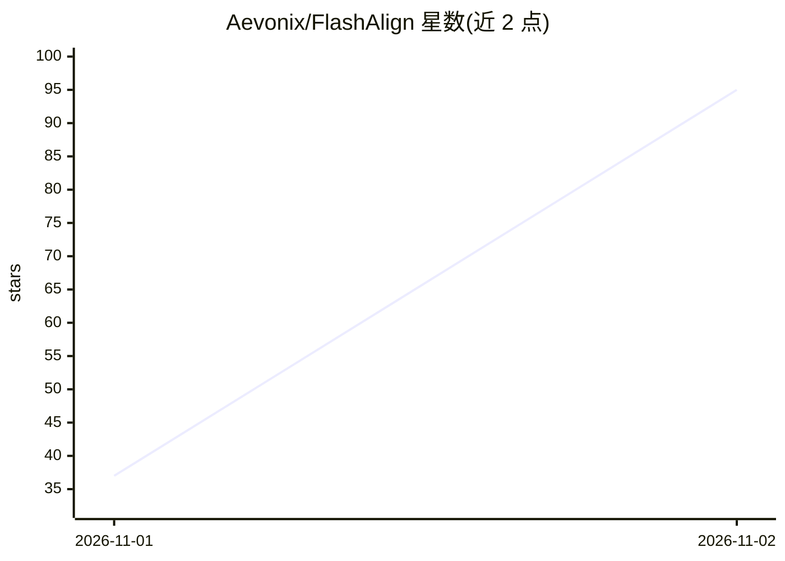

# Aevonix/FlashAlign

⭐ 95 · Python · AGPL-3.0 · 推送 2026-11-01 · [GitHub](https://github.com/Aevonix/FlashAlign) · [官网](https://aevonix.com) · 组织维护

**按请求切换模型对齐（abliteration）画像的推理路由工具**

面向已部署 LLM 推理引擎的对齐切换层：为 DeepSeek、GLM、Qwen、Gemma 等模型提供 V1 拒答削减 starter profiles，按请求或常开方式应用，不永久修改权重。支持 TensorFold、vLLM、SGLang、llama.cpp 引擎，可配合 Hermes、OpenClaw 或自定义 harness 运行；内置 WhatsApp/RCS/SMS/Telegram 消息适配与联系人验证机制。托管推理需 Linux 与 NVIDIA GPU，starter profiles 被标注为实验性。

## 筛选速览

| 维度 | 判定 | 备注 |
|---|---|---|
| AI 角色 | `ai-ecosystem` | LLM/agent 周边工具 |
| 许可风险 | `viral` | AGPL-3.0 |
| 部署形态 | `None` |  |
| 模型依赖 | local-ok | 支持本地模型 |
| 硬件要求 | — | 无带数字的原话,不猜 |
| 安装摩擦 | `low` | 无编译、无系统依赖或容器化 |
| 成熟度 | `idea` | |

## 能力要点

- 按请求或 Always On 应用 abliteration 对齐画像，不永久改动权重
- 支持 TensorFold/vLLM/SGLang/llama.cpp 四类引擎与五个 starter profiles
- Verified contacts 联系人验证模式，覆盖 WhatsApp/RCS/SMS/Telegram 通道
- 可与 Hermes、OpenClaw 或自定义 harness 集成

## 适用场景

- 为已验证用户/频道按需开启削弱拒答的模型画像
- 在自建推理网关上常开指定对齐画像
- 在 agent harness（Hermes/OpenClaw）中按工具控制画像继承

## 场景标签

`模型网关` · 领域:Agent 开发

## 证据(README 行号)

> L13: Apply alignment profiles per request. Use abliteration for approved users and
> L17: changing them. Run it directly, with Hermes or OpenClaw, or through your own
> L57: |DeepSeek V4.1 Flash 1017|TensorFold, vLLM|

## 星数曲线

2026-11-01 37 → 2026-11-02 95（+58）

---
*卡片 v1 · prompt 1.4 · 生成 2026-10-31 · 置信度 high · 依据 README sha `712dce6c2b02` · [字段定义](../../DATASET.md)*
