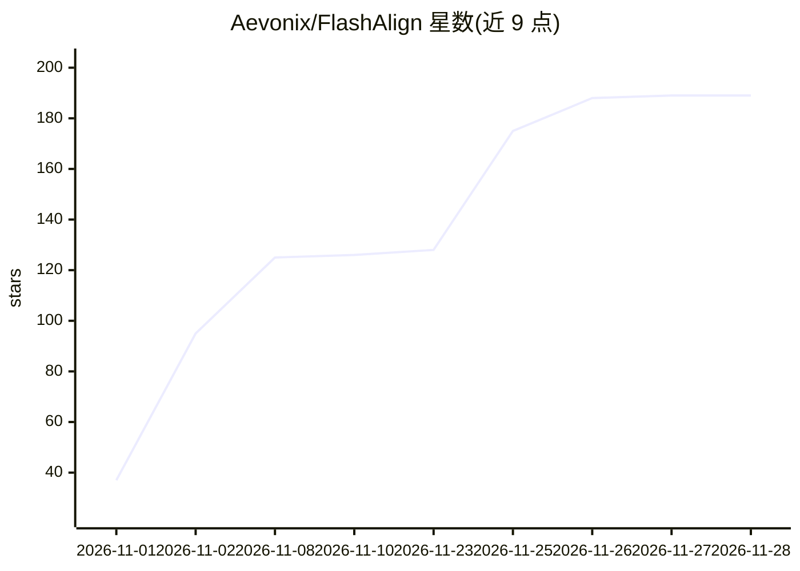

# Aevonix/FlashAlign

⭐ 189 · Python · AGPL-3.0 · 推送 2026-11-18 · [GitHub](https://github.com/Aevonix/FlashAlign) · [官网](https://aevonix.com) · 组织维护

**按请求对 LLM 施加对齐配置的运行时网关工具**

FlashAlign 由 Aevonix Research 发布，对已下载的基座或量化模型按请求应用对齐配置（profile），不永久修改权重；提供 Verified contacts（仅经核验的联系人/通道生效）与 Always On（对所有路由请求生效）两种模式，内置 5 个以拒绝减少为主题的启动配置，并提供状态检查、doctor 探测、dashboard 监控与配置管理脚本。部署要求 Linux 与 NVIDIA GPU，通过 install.sh 脚本安装，面向需要按用户/通道控制模型对齐行为的自托管推理使用者。

## 筛选速览

| 维度 | 判定 | 备注 |
|---|---|---|
| AI 角色 | `ai-ecosystem` | LLM/agent 周边工具 |
| 许可风险 | `viral` | AGPL-3.0 |
| 部署形态 | `None` |  |
| 模型依赖 | local-ok | 支持本地模型 |
| 硬件要求 | — | 无带数字的原话,不猜 |
| 安装摩擦 | `low` | 无编译、无系统依赖或容器化 |
| 成熟度 | — | 结构信号不足 |

## 能力要点

- 按请求应用对齐配置，无需永久修改基座或量化权重
- Verified contacts / Always On 两种生效模式，支持工具继承开关
- 支持 vLLM、SGLang、TensorFold、llama.cpp 等多种引擎的模型组合
- 提供 status/doctor/dashboard 运维命令与配置哈希校验

## 适用场景

- 仅对经核验的用户和消息通道应用 abliteration 配置
- 在自托管网关上对所有路由请求统一施加对齐配置
- 在已运行的推理引擎上接入对齐配置而更换模型

## 场景标签

`模型网关` · 领域:Agent 开发

## 证据(README 行号)

> L13: Apply alignment profiles per request. Use abliteration for approved users and
> L155: Always On gateway. FlashAlign controls only
> L221: |Inference host|Linux and NVIDIA GPU; matched CPU and GPU architecture for TensorFold bundles|

## 星数曲线

2026-11-01 37 → 2026-11-28 189（+152）

---
*卡片 v1 · prompt 1.4 · 生成 2026-11-26 · 置信度 high · 依据 README sha `da21b11dce3d` · [字段定义](../../DATASET.md)*
